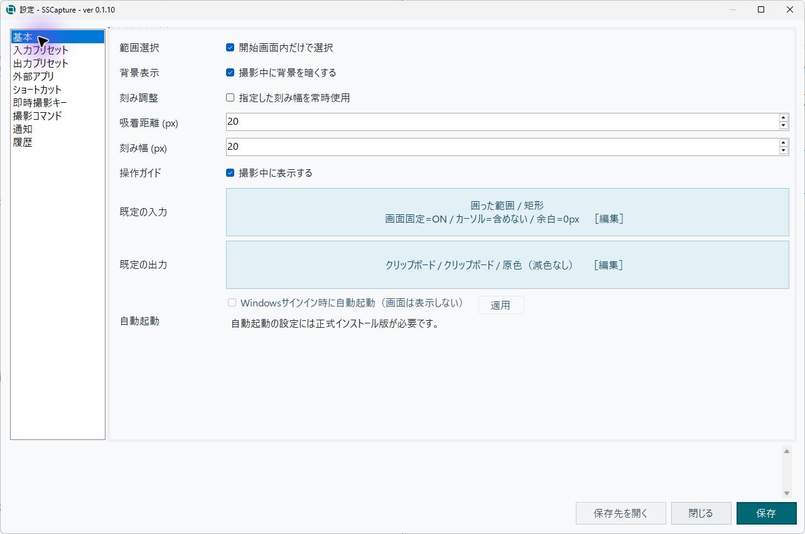
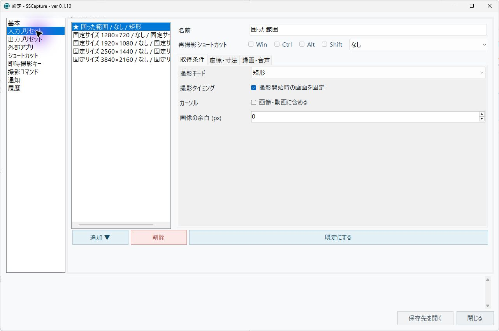
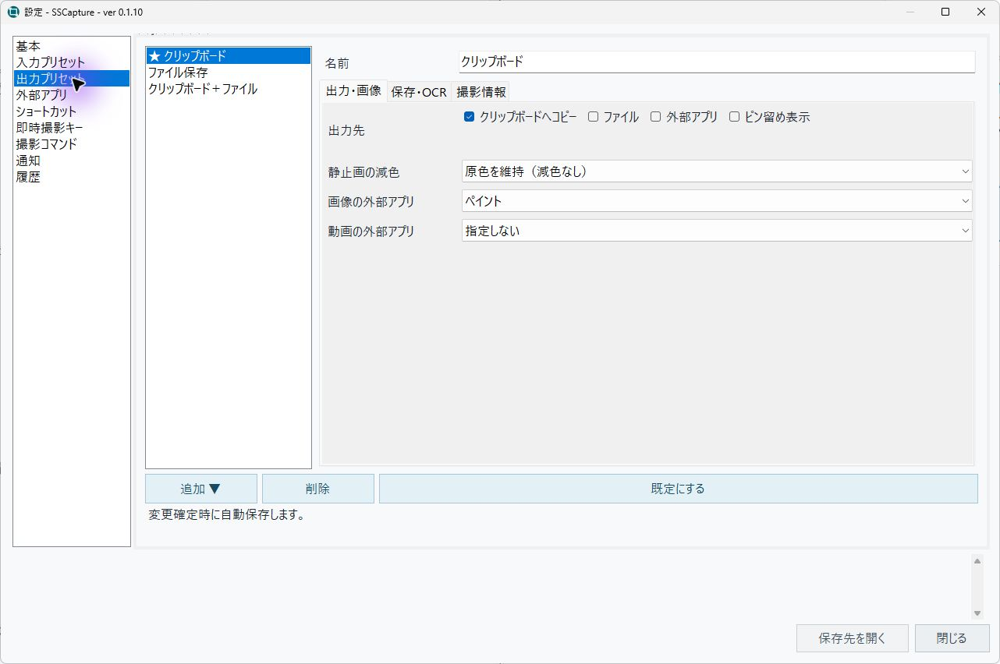

# SSCapture

Windows 11用の軽快な常駐スクリーンショット・領域録画ツールです。Windows標準の **Win＋Shift＋S（Snipping Tool）** を置き換え、範囲の決めやすさ、繰り返し撮影、撮影後の出力を重視しています。

## 本ツールの特徴・Windows標準の撮影との違い

1. **解像度が異なる複数ディスプレイに対応。** モニタごとの物理ピクセル座標で範囲を扱い、画面の角で離したときの取りこぼしに対処しています。開始モニタだけでの選択と、複数モニタをまたぐ選択を切り替えられます。
2. **開いているメニューも一度の操作で撮影。** スタートメニューやタスクバーのメニューを撮りたいときも、撮影開始時の画面を固定して、そのまま囲めます。「撮影開始時の画面を固定」をONにして使います。
3. **キーを併用して正確に囲める。** Shiftで横方向だけ、Ctrlで縦方向だけに範囲を拡大・縮小できます。キーを離すと選択端がポインタ位置へ戻ります。Altでウィンドウ枠やモニタ端へスナップ、矩形ドラッグ中のSpaceで現在位置から囲み直せます。右クリックで16:9・4:3・1:1にも固定できます。
4. **軽快な常駐型。** 撮影と出力に役割を絞り、編集は必要なときだけ外部アプリへ渡します。毎回編集画面を開かずに撮影を続けられます。
5. **範囲の寸法を指定したピクセル単位で調整。** 刻み幅の既定は1px、枠への吸着距離は20pxです。刻み幅は右クリックメニューで常時ONにするか、スナップ操作中に適用できます。
6. **ウィンドウ・画面全体を素早く撮影。** 左クリックだけで対象ウィンドウを、中央クリックでそのモニタ全体を選べます。ウィンドウ撮影ではドラッグして囲う必要がありません。
7. **固定サイズの枠をスタンプのように位置決め。** 矩形・自由形状・ウィンドウ・全画面に加え、幅・高さをピクセル単位で指定する固定サイズ撮影に対応。基点を4隅から選び、同じ大きさの枠を撮りたい場所へ重ねられます。
8. **コピー・保存・編集アプリへの送信を併用。** 撮影と同時にクリップボードへコピーし、ファイルへ保存し、外部編集アプリで開く操作を組み合わせられます。必要な出力だけを個別に選ぶこともできます。
9. **直前の範囲を何度でも、静かな通知で。** Win＋Ctrl＋Shift＋Sで前回と同じ場所をワンタッチ再撮影できます。完了表示は小さく、既定では1秒で消えます。表示時間・効果音を変更でき、通知をOFFにもできます。
10. **撮影画像の周りに白い余白を追加。** 入力プリセットの「画像の余白 (px)」で、対象範囲の外側へ上下左右同じ幅の白枠を付けられます。0pxは余白なし。元画像を縮小せず、コピー・保存・外部アプリへの出力に共通で適用します。
11. **今回だけの余白と出力プリセット。** 撮影中の右クリックで余白を一時変更したり、入力条件と出力先・保存先・命名の組合せを呼び出せます。既定設定は変わりません。固定サイズのSpaceは基点を時計回りに切り替えます。
12. **出力に失敗しても撮り直し不要。** 直近の静止画について、トレイの「失敗した出力を再実行」で失敗した処理だけをやり直せます。成功済みのコピーや保存を繰り返しません。保持条件は[使い方](docs/usage.md)を参照してください。
13. **256色・16色へ減色。** 出力プリセットの「静止画の減色」で、8ビット（最大256色）または4ビット（最大16色）のパレットPNGを出力できます。画像の寸法は変わりません。既定は減色なしです。
14. **撮影情報を選んで記録。** 静止画のファイル保存時に、ポインタの相対位置・フォーカスUI・アプリ情報をPNG内XMP／別JSON／両方で記録できます。既定は記録なしです。UI名や実行パスを含むため、共有前に内容を確認してください。
15. **通知から画像をドラッグ。** 小さな撮影画像をフォルダへドロップすると移動、Ctrlを押すとコピーできます。画像ファイルのドロップに対応するアプリへ渡して開く・取り込む操作にも使えます。

新規設定では、入力5件（囲った範囲＋720p/1080p/1440p/4Kの固定サイズ）と出力3件を用意します。既定は矩形選択＋クリップボードのみで、画面固定ON・カーソルOFF・白余白なし・減色なし・px吸着OFF。暗転は基本設定で初期ONです。既存の編集済みプリセットやスナップ設定は保持します。

[プレリリースのダウンロード](https://github.com/KotorinChunChun/SSCapture/releases/tag/v0.1.9)・[リリースノート](docs/releases/v0.1.9.md)を参照してください。未署名のプレリリースです。KotorinToysのツール一覧からもインストール・更新できます。

矩形・ウィンドウ・全画面撮影などはWindows標準にもあります。本ツールは上記の操作と出力の組み合わせを提供します。標準機能の案内は[Microsoft公式のSnipping Toolの使い方](https://support.microsoft.com/ja-jp/windows/apps/use-snipping-tool-to-capture-screenshots)、対応範囲と未確認条件は[検証状況](dev/validation.md)を参照してください。

## 本ツールが適している用途

静止画を画面上へ残して比較・参照したい場合は、出力プリセットの「ピン留め表示」を使えます。複数枚の枠なし・最前面表示、ペン/図形/文字、回転、描画込みのコピー・保存に対応します。設定の「撮影コマンド」から、範囲を囲む方式と固定座標方式のPowerShellコマンドも生成できます。[操作方法](docs/usage.md#静止画のピン留め)を参照してください。

- 最前面にある、ユーザーが実際に見ている画面をそのまま撮影する。
- 複数のウィンドウやダイアログ、メニューをまたいだ領域をまとめて撮影する。
- 任意の領域を囲む、固定サイズで位置を決める、同じ場所を繰り返し撮影する。
- 普段の操作感をなるべく壊さず、撮影後すぐに元の作業へ戻る。
- アプリの解像度を計測する。ウィンドウや任意の表示領域を選択し、枠に表示される幅・高さを物理ピクセル単位で確認する（アプリの描画領域を測る場合は、その内側を囲んでください）。

## 本ツールが適さない用途

1. **1枚のデスクトップモニタを超える領域の撮影を主に使う場合。** 設定の「開始画面内だけで選択」をOFFにすれば複数モニタをまたげますが、ポインタを開始モニタ内に留めることや、他モニタへ選択画面を重ねず動画などの表示を続けることといった、既定動作のメリットを失います。
2. **常駐型アプリを導入・起動できない環境。** 本ツールはトレイに常駐して撮影操作を受け付けます。
3. **Windows標準の撮影機能を100%忠実に再現したい場合。** 操作感や軽快さを優先し、意図的に採用していない機能もあります。標準機能との完全互換を目指すツールではありません。
4. **背面・他のウィンドウに隠れた非アクティブウィンドウの単独撮影や、WGCによる撮影。** 本ツールはデスクトップ上に見えている画面を取得します。非アクティブでも見えている部分は撮影できますが、隠れた内容をウィンドウ単位で取得する用途には向きません。

## CapchunScreenとの使い分け

**特定のウィンドウ全体を対象にしたキャプチャや、特定ウィンドウの画面録画を重視する場合は、[CapchunScreen](https://github.com/KotorinChunChun/CapchunWindow)をおすすめします。**

CapchunScreenのウィンドウ取得はWGC（Windows Graphics Capture）を使い、GPU上の対象ウィンドウの映像を取得します。他のウィンドウの重なりに影響されず、決まったウィンドウを安定して記録したい用途に適しています。ただし、最小化・保護された映像など、対象や環境による取得制約はあります。

一方、ダイアログやメニューを含む複数ウィンドウをまとめて撮影したい場合や、見えている画面の任意の領域を囲みたい場合は、本ツールをおすすめします。用途が重なる部分は、操作感や好みで選んでください。

## GitHub開発版インストーラー

[Releases](https://github.com/KotorinChunChun/SSCapture/releases)でWindows 11 x64向けのランタイム同梱インストーラーを配布します。未署名の開発版です。設定・保存した撮影結果は削除時も保持します。

公開インストーラーにはFFmpeg／FFprobeとOneOCRの外部ファイルを同梱しません。録画には信頼できる配布元から取得した`ffmpeg.exe`と`ffprobe.exe`を導入先の`tools`へ配置する必要があります。[FFmpeg公式の取得案内](https://ffmpeg.org/download.html)を参照してください。録画依存物がない場合も画面撮影は利用できます。

Windows 11用の常駐スクリーンショット・領域録画ツールです。クリップボード・ファイル保存・外部アプリへの出力を個別にON/OFFできます。既定はクリップボードだけONです。編集は指定した外部アプリで行います。

## 起動

インストール後、スタートメニューのSSCaptureを起動します。起動すると設定画面が開きます。

| 操作 | 既定のキー・方法 |
| --- | --- |
| 静止画 | Win＋Shift＋S / PrintScreen |
| 録画 | Win＋Shift＋R → 領域選択 → 開始ボタン |
| 即時撮影 | Win＋Shift＋1～9 / 0（画面1は主画面） |
| 前回範囲の再撮影 | Win＋Ctrl＋Shift＋S |
| 設定 | トレイをダブルクリック |
| 終了 | トレイを右クリック → 終了 |

通常選択では左ドラッグで範囲、左クリックだけでウィンドウ、中央クリックで対象画面全体を選びます。矩形ドラッグ中にSpaceを押すと、選択範囲を保ったまま対角側を調整できます。撮影中にWinを単押しすると、ポインタ下のウィンドウを強調し、もう一度押すと解除します。撮影・録画の起動キーと撮影中の修飾キーは「ショートカット」から設定できます。

## 画面で見る使い方

設定・入力・出力・範囲・メニューは0.1.10の開発版の例です。設定は隔離したプレビュー、撮影対象は合成画像です。実設定・実画面・クリップボードには触れていません。

### 1. 基本設定を確認する

撮影範囲、暗転、刻み幅、既定の入力・出力を確認します。既定欄の「編集」から対応するプリセットへ移動できます。

### 2. 入力プリセットで撮り方を決める

「入力プリセット」で矩形や固定サイズを選び、画面固定・カーソル・余白を設定します。座標・寸法、録画音声もこの画面で切り替えます。

### 3. 出力先を決める

「出力プリセット」でコピー、ファイル保存、外部アプリ、ピン留めを選びます。複数を併用でき、通常版では変更確定時に自動保存されます。

### 4. 範囲を指定する

固定サイズは枠を移動して左クリックで確定します。画像は320×180pxの枠の例です。矩形モードでは左ドラッグで囲みます。

### 5. 撮影中だけ条件を変える

右クリックからプリセットや一時カスタマイズを選びます。「撮影をキャンセル」で保存せずに終了します。

## 撮影結果の確認

通知を有効にして撮影すると、画像のプレビューとコピー・保存の結果が表示されます。下の0.1.9の例では640×360ピクセルの画像がクリップボードにコピーされています。再撮影のキーは通知に表示された割り当てを確認してください。

## 案内

- [使い方](docs/usage.md)：撮影・録画・OCR命名・プリセット・履歴・通知
- [第三者ライセンス・配布元](THIRD_PARTY.md)
- [開発者向け資料](docs/DEVELOPERS_GUIDE.md)：ビルド・検証・公開手順

Windows 11 x64が対象です。公開インストーラーには.NET 10 Desktop Runtimeを同梱します。ローカルの`artifacts/app`はランタイムを別途必要とします。設定と作業データは実行ファイル横の `data` に保存します。実行フォルダは書き込み可能な場所を使い、利用済みの `artifacts/app` をそのまま配布しないでください。
