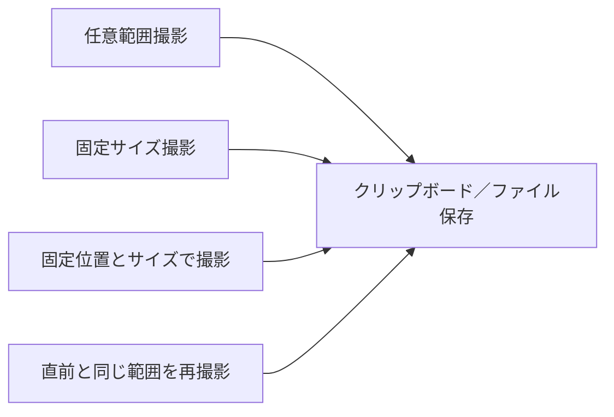
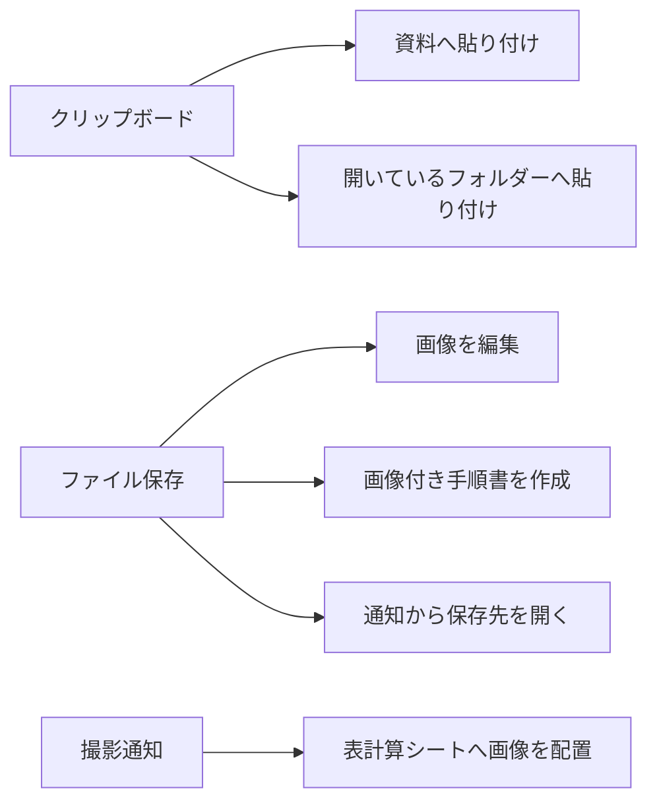
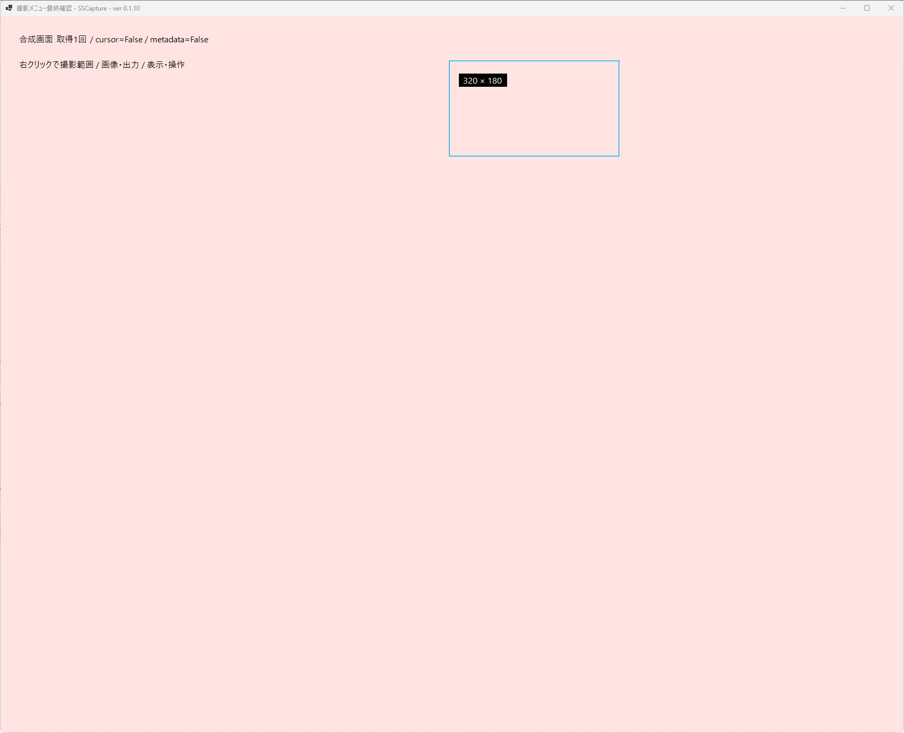
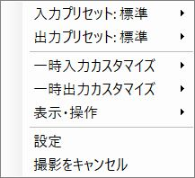
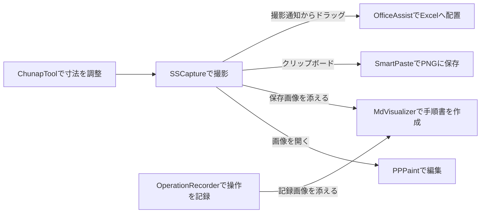

# SSCapture

Windows 11用の軽快な常駐スクリーンショット・領域録画ツールです。Windows標準の **Win＋Shift＋S（Snipping Tool）** を置き換え、範囲の決めやすさ、繰り返し撮影、撮影後の出力を重視しています。

## 想定活用フロー

### インプット

### アウトプット

出力方法と保存先は出力プリセットで指定します。[おすすめ連携ツール](#おすすめ連携ツール)・[用途別の操作例](docs/usage.md#用途別の操作例)

## 本ツールの特徴

1. **解像度が異なる複数ディスプレイに対応。** モニタごとの物理ピクセル座標で範囲を扱い、画面の角で離したときの取りこぼしに対処しています。開始モニタだけでの選択と、複数モニタをまたぐ選択を切り替えられます。
2. **開いているメニューも一度の操作で撮影。** スタートメニューやタスクバーのメニューを撮りたいときも、撮影開始時の画面を固定して、そのまま囲めます。「撮影開始時の画面を固定」をONにして使います。
3. **キーを併用して正確に囲める。** Shiftで縦横比を固定し、Ctrlで起点を中心に広げ、Ctrl＋Shiftで両方を適用します。Alt＋Shiftは横方向、Alt＋Ctrlは縦方向だけを調整します。Altでウィンドウ枠にスナップし、Spaceで範囲を保ったまま対角側を調整できます。
4. **軽快な常駐型。** 撮影と出力に役割を絞り、編集は必要なときだけ外部アプリへ渡します。毎回編集画面を開かずに撮影を続けられます。
5. **範囲の寸法を指定したピクセル単位で調整。** グリッド間隔は既定1px、ウィンドウスナップ距離は既定20pxです。グリッドスナップは右クリックメニューで既定をONにするか、割り当てたキーで一時的に使えます。
6. **ウィンドウ・画面全体を素早く撮影。** 左クリックだけで対象ウィンドウを、中央クリックでそのモニタ全体を選べます。ウィンドウ撮影ではドラッグして囲う必要がありません。
7. **固定サイズの枠をスタンプのように位置決め。** 矩形・自由形状・ウィンドウ・全画面に加え、幅・高さをピクセル単位で指定する固定サイズ撮影に対応。基点を四隅と中心から選び、同じ大きさの枠を撮りたい場所へ重ねられます。
8. **コピー・保存・編集アプリへの送信を併用。** 撮影と同時にクリップボードへコピーし、ファイルへ保存し、外部編集アプリで開く操作を組み合わせられます。必要な出力だけを個別に選ぶこともできます。
9. **直前の範囲を何度でも、静かな通知で。** Win＋Ctrl＋Shift＋Sで前回と同じ場所をワンタッチ再撮影できます。完了表示は小さく、既定では1秒で消えます。表示時間・効果音を変更でき、通知をOFFにもできます。
10. **撮影画像の周りに白い余白を追加。** 入力プリセットの「画像の余白 (px)」で、対象範囲の外側へ上下左右同じ幅の白枠を付けられます。0pxは余白なし。元画像を縮小せず、コピー・保存・外部アプリへの出力に共通で適用します。
11. **今回だけの余白と出力プリセット。** 撮影中の右クリックで余白を一時変更したり、入力条件と出力先・保存先・命名の組合せを呼び出せます。既定設定は変わりません。固定サイズのSpaceは基点を時計回りに切り替えます。
12. **出力に失敗しても撮り直し不要。** 直近の静止画について、トレイの「失敗した出力を再実行」で失敗した処理だけをやり直せます。成功済みのコピーや保存を繰り返しません。保持条件は[使い方](docs/usage.md)を参照してください。
13. **256色・16色へ減色。** 出力プリセットの「静止画の減色」で、8ビット（最大256色）または4ビット（最大16色）のパレットPNGを出力できます。画像の寸法は変わりません。既定は減色なしです。
14. **撮影情報を選んで記録。** 静止画のファイル保存時に、ポインタの相対位置・フォーカスUI・アプリ情報をPNG内XMP／別JSON／両方で記録できます。既定は記録なしです。UI名や実行パスを含むため、共有前に内容を確認してください。
15. **通知から画像をドラッグ。** 小さな撮影画像をフォルダへドロップすると移動、Ctrlを押すとコピーできます。画像ファイルのドロップに対応するアプリへ渡して開く・取り込む操作にも使えます。

新規設定では、入力5件（囲った範囲＋720p/1080p/1440p/4Kの固定サイズ）と出力3件を用意します。既定は矩形選択＋クリップボードのみで、画面固定ON・カーソルOFF・白余白なし・減色なし・グリッドOFF。暗転は基本設定で初期ONです。既存の編集済みプリセットやスナップ設定は保持します。

[公開済みプレリリースのダウンロード](https://github.com/KotorinChunChun/SSCapture/releases)・[この文書の対象版（v0.1.10）のリリースノート](docs/releases/v0.1.10.md)を参照してください。未署名のプレリリースです。KotorinToysのツール一覧からもインストール・更新できます。

## Windows標準のSnipping Toolとの違い

〇は対応、×は各アプリの標準機能として確認できない項目です。Snipping Toolの機能はWindowsやアプリのバージョンによって異なります。

| 機能 | SSCapture | Snipping Tool（Windows 11標準） |
| --- | :---: | :---: |
| 矩形・自由形状・ウィンドウ・全画面の静止画撮影 | 〇 | 〇 |
| スタートメニューなどを開いた状態の撮影 | 〇（開始時の画面を固定） | 〇（遅延撮影など） |
| 静止画のクリップボードコピー・自動ファイル保存 | 〇 | 〇 |
| 画面の一部を選んで録画 | 〇（FFmpeg・FFprobeが必要） | 〇 |
| 録画用ツールを追加せずに領域録画 | × | 〇 |
| 静止画にペンや図形で注釈 | 〇（ピン留め画像） | 〇 |
| アプリ内のタイマーで静止画撮影を遅らせる | × | 〇 |
| 撮影した画像からOCRで文字列を抽出してコピー | ×（OCRは主にファイル命名に使用） | 〇（テキスト アクション） |
| ピクセル単位で指定した固定サイズ・固定座標で撮影 | 〇 | × |
| ドラッグ中の縦横比固定・中心からの拡大・グリッドスナップ | 〇 | × |
| 中ボタンドラッグで選んだ複数のモニターを1枚に合成 | 〇 | × |
| 前回と同じ範囲や入出力設定で再撮影 | 〇 | × |
| 入力・出力プリセットを撮影中に切り替え | 〇 | × |
| 撮影時に指定した外部編集アプリを自動で開く | 〇 | × |
| 通知の小画像をドラッグしてフォルダーや他のアプリへ渡す | 〇 | × |
| 静止画を最前面にピン留めして表示 | 〇 | × |
| 指定した幅の白い余白を付ける・256色や16色に減色する | 〇 | × |
| 撮影時のポインタ位置やウィンドウ名をXMP・JSONに記録 | 〇 | × |
| コマンドラインから静止画を撮影 | 〇 | × |

[Microsoft公式のSnipping Toolの使い方](https://support.microsoft.com/ja-jp/windows/apps/use-snipping-tool-to-capture-screenshots)・[SSCaptureの使い方](docs/usage.md)・[SSCaptureの検証状況](dev/validation.md)

## 本ツールが適している用途

| やりたいこと | SSCaptureで使う機能 |
| --- | --- |
| スタートメニューや右クリックメニューを撮る | 撮影開始時に画面を固定してから囲む |
| 見えている画面、対象ウィンドウ、モニター全体を撮り分ける | 左ドラッグ・左クリック・Win短押し・中ボタンを使い分ける |
| 同じ寸法で撮る、画面の一部の解像度を測る | 固定サイズの入力プリセット、または選択枠の幅と高さの表示を使う |
| 手順の前後を同じ範囲・条件で撮る | 「前回の範囲」か「直前の設定で再撮影」を使う |
| 資料へ貼り付けながらPNGも残す | 出力プリセットの「クリップボード＋ファイル」を選ぶ |
| 通知から画像を編集・整理する | サムネイルのダブルクリックやドラッグを使う |
| 撮影画像を画面に残し、注釈を付ける | 「ピン留め表示」で最前面に置き、ペンや文字を使う |
| アプリの操作を動画にする | 範囲を指定し、PC再生音とマイクを個別に選んで録画する |

[用途別の操作例](docs/usage.md#用途別の操作例)・[撮影方法の選び方](docs/usage.md#撮影方法の選び方)

アプリの描画領域だけを測る場合は、タイトルバーと枠を除いた内側を囲み、選択枠の幅・高さを確認してください。

繰り返す撮影をPowerShellで実行したい場合は、設定の「撮影コマンド」で範囲選択方式や固定座標方式のコマンドを生成できます。[撮影コマンド](docs/usage.md#撮影コマンド)

## 本ツールが適さない用途

1. **1枚のデスクトップモニタを超える領域の撮影を主に使う場合。** 設定の「開始したモニター内で選択する」をOFFにすれば複数モニタをまたげますが、ポインタを開始モニタ内に留めることや、他モニタへ選択画面を重ねず動画などの表示を続けることといった、既定動作のメリットを失います。
2. **常駐型アプリを導入・起動できない環境。** 本ツールはトレイに常駐して撮影操作を受け付けます。
3. **Windows標準の撮影機能を100%忠実に再現したい場合。** 操作感や軽快さを優先し、意図的に採用していない機能もあります。標準機能との完全互換を目指すツールではありません。
4. **最小化されたウィンドウや保護された映像の撮影。** ウィンドウ単独取得を選んだ場合も、取得できる条件は対象アプリとWindowsに依存します。

## CapchunScreenとの使い分け

**特定のウィンドウ全体を対象にしたキャプチャや、特定ウィンドウの画面録画を重視する場合は、[CapchunScreen](https://github.com/KotorinChunChun/CapchunWindow)をおすすめします。**

CapchunScreenのウィンドウ取得はWGC（Windows Graphics Capture）を使い、GPU上の対象ウィンドウの映像を取得します。他のウィンドウの重なりに影響されず、決まったウィンドウを安定して記録したい用途に適しています。ただし、最小化・保護された映像など、対象や環境による取得制約はあります。

一方、ダイアログやメニューを含む複数ウィンドウをまとめて撮影したい場合や、見えている画面の任意の領域を囲みたい場合は、本ツールをおすすめします。用途が重なる部分は、操作感や好みで選んでください。

## GitHub開発版インストーラー

[Releases](https://github.com/KotorinChunChun/SSCapture/releases)でWindows 11 x64向けのランタイム同梱インストーラーを配布します。未署名の開発版です。設定・保存した撮影結果は削除時も保持します。

録画を使う場合は、`ffmpeg.exe` と `ffprobe.exe` を導入先の `tools` へ配置してください。録画キーを押すと、ファイルが不足している場合に配置先が表示されます。静止画は導入直後から撮影できます。[録画の準備](docs/usage.md#録画の準備)

Windows 11用の常駐スクリーンショット・領域録画ツールです。クリップボード・ファイル保存・外部アプリへの出力を個別にON/OFFできます。既定はクリップボードだけONです。編集は指定した外部アプリで行います。

## 起動

インストール後、スタートメニューのSSCaptureを起動します。起動すると設定画面が開きます。

| 操作 | 既定のキー・方法 |
| --- | --- |
| 静止画 | Win＋Shift＋S / PrintScreen |
| 録画 | Win＋Shift＋R → 領域選択 → 開始ボタン |
| 即時撮影 | Win＋Shift＋1～9 / 0（画面1は主画面） |
| 前回範囲の再撮影 | Win＋Ctrl＋Shift＋S |
| 設定 | トレイをダブルクリック |
| 終了 | トレイを右クリック → 終了 |

通常選択では左ドラッグで範囲、左クリックだけでウィンドウ枠内に見えている画面、中央クリックで対象モニタ全体を選びます。ドラッグ前にWinを単押しすると、対象ウィンドウをWGCで取得してプレビューし、その画像を撮影できます。もう一度Winを押すと元のモードへ戻ります。ドラッグ前のAlt単押しではウィンドウスナップを切り替えます。撮影前とドラッグ中の操作は「ショートカット」から設定できます。

## 画面で見る使い方

以下はv0.1.10の画面例です。まず「入力プリセット」で撮り方を、「出力プリセット」で撮った後の処理を決めます。

### 1. 基本設定を確認する

選択範囲、位置・寸法の補正、操作ガイド、既定プリセット、自動起動を設定します。既定プリセットの「編集」から対応する設定へ移動できます。

### 2. 入力プリセットで撮り方を決める

「入力プリセット」で矩形や固定サイズを選び、画面固定・カーソル・余白を設定します。座標・寸法、録画音声もこの画面で切り替えます。

### 3. 出力先を決める

「出力プリセット」でコピー、ファイル保存、外部アプリ、ピン留めを選びます。資料に貼る分と保管する分を一度に作りたい場合は「クリップボード＋ファイル」が使えます。プリセットの変更は確定時に自動保存されます。

### 4. 範囲を指定する

固定サイズは枠を移動して左クリックで確定します。画像は320×180pxの枠の例です。矩形モードでは左ドラッグで囲みます。

### 5. 撮影中だけ条件を変える

右クリックからプリセットや一時カスタマイズを選びます。「撮影をキャンセル」で保存せずに終了します。

## 撮影結果の確認

通知には対象のウィンドウ名または撮影位置・寸法と、コピー・保存の結果が表示されます。ファイル保存に成功した場合は「フォルダを開く」が使えます。通知の小画像をダブルクリックすると、割り当て済みの編集アプリで開きます。下の画像はv0.1.9の通知例です。[通知の操作](docs/usage.md#完了表示と効果音)

## おすすめ連携ツール

- **[OperationRecorder](https://github.com/KotorinChunChun/OperationRecorder)**は、PCを操作しながら各手順のスクリーンショットを記録できます。手順書用に一連の操作を記録し、必要なカットをSSCaptureで撮り足せます。
- **[PPPaint](https://github.com/KotorinChunChun/PPPaint)**は、撮影画像に文字や図形を書き込んだり、レイヤーを使って編集したりできます。SSCaptureの外部アプリに登録して通知の編集先に指定すると、通知の小画像をダブルクリックして開けます。
- **[MdVisualizer](https://github.com/KotorinChunChun/MdVisualizer)**は、SSCaptureで撮った画像を添えて、Markdown（.md）で手順書を執筆できます。プレビューで文章と画像の配置を確認しながら編集できます。
- **[ChunapTool](https://github.com/KotorinChunChun/ChunapTool)**は、撮影前に指定ウィンドウの幅・高さをピクセル単位で微調整できます。同じ寸法のウィンドウを並べて比較したり、複数の撮影で画像サイズを揃えたりする用途に使えます。
- **[SmartPaste](https://github.com/KotorinChunChun/SmartPaste)**を起動しておくと、SSCaptureでコピーした画像をエクスプローラーのフォルダー内で **Ctrl＋V** してPNGに保存できます。保存画面の「OCR」で読み取った文字をファイル名の候補にできます。
- **[OfficeAssist](https://github.com/KotorinChunChun/OfficeAssist)**を起動しておくと、SSCaptureの撮影通知にある小画像をデスクトップ版Excelのシートへドラッグ＆ドロップして、画像を直接配置できます。

## 案内

- [使い方](docs/usage.md)：撮影・録画・OCR命名・プリセット・履歴・通知
- [第三者ライセンス・配布元](THIRD_PARTY.md)
- [開発者向け資料](docs/DEVELOPERS_GUIDE.md)：ビルド・検証・公開手順

Windows 11 x64が対象です。公開インストーラーには.NET 10 Desktop Runtimeを同梱します。ローカルの`artifacts/app`はランタイムを別途必要とします。設定と作業データは実行ファイル横の `data` に保存します。実行フォルダは書き込み可能な場所を使い、利用済みの `artifacts/app` をそのまま配布しないでください。

## 使用言語とライブラリ

- 使用言語はC#です。
- .NET 10、Windows Forms。音声入力にはNAudio.Wasapiを使います。録画・動画情報の取得には外部プログラムのFFmpeg・FFprobe、文字認識にはWindowsのOneOCRを使います。
- 依存定義と資料 [プロジェクトの依存定義](src/SSCapture/SSCapture.csproj)・[第三者コンポーネント](THIRD_PARTY.md)

## ライセンス

SSCaptureの独自コードと文書には[MITライセンス](LICENSE)が適用されます。FFmpegなどの第三者コンポーネントには、それぞれのライセンスが適用されます。詳しくは[第三者コンポーネント](THIRD_PARTY.md)を参照してください。
