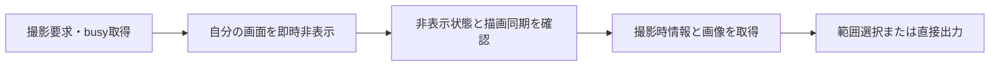

# v0.2.0 設計・実装計画

2026年10月20日。基準ソース: `60fce77a2c3390e90592f531ca970a85aa04fed1`（v0.1.2公開結果を含むmain）。設計のみ。製品コード、設定データ、配布物は変更していない。

[要求](v0.2.0-req.md) / [進捗・検証計画](v0.2.0-task.md)

## 1. 現状と設計の要点

| 要求 | 現行コードで確認した事実 | 設計 |
| --- | --- | --- |
| R01 | `TakeCaptureAsync`で設定等を`Hide`し、`CaptureSession.SelectAsync`が即座に初回スナップショットを取得。初回経路に描画同期なし | 自分の画面をアニメーションなしで隠し、描画同期後に取得 |
| R02 | `CaptureFeedback`のタイマー満了が直接`HideForCapture`へ接続され、ポインタ判定なし | 近接中は期限を進めず、離脱後に猶予を設ける |
| R03 | `CaptureOverlay.OnPaint`が常に黒の半透明塗りを行う | 暗転を独立設定にし、既定OFF |
| R04 | 保存フォルダ・命名欄が常に操作可能。`AppSettings.Validate`もファイル保存の有無を問わず検証 | UIの有効状態と実行時の使用条件を一致させる |
| R05 | 画像用・動画用にそれぞれexeと引数が1組。`EditorPresets`は入力例であり利用者の登録一覧ではない | 外部アプリを複数登録し、用途ごとに1つ選択 |
| R06 | 設定タブは「プリセット」、撮影メニューは「撮影プリセット」 | 利用者向け名称を「出力プリセット」に統一 |
| R07 | UIA採取・画像への付加情報保存は未実装。カーソル描画用の位置は`CursorSnapshot`が保持 | 時刻付きの共通データを採取し、XMP・JSONへ変換 |
| R08 | `HistoryForm`は別ウィンドウだが、設定は「範囲・履歴」に混在 | 設定の分類も分離。履歴のメモリー保持を継続 |
| R09 | `RegionManagerForm`、`SavedRegion`、登録範囲メニューが存在 | 表示名を「入力プリセット」に統一 |
| R10 | `SavedRegion.Shortcut`、編集欄、`HotkeyBinding.ReadAssignments`、`TakeRegionAsync`は実装済み | 既存経路を活用し、キー欄・一覧・説明を明確にする |

R01はコードから分かる競合の可能性であり、この設計作業で実機のフェード残像を再現した結果ではない。アプリ独自のフェード処理は確認できず、Windowsの画面合成との順序を優先して調べる。

主な参照元（すべて現行ファイル）:

- [撮影開始](../../../src/SSCapture/TrayApplicationContext.Capture.cs)、[初回画像取得](../../../src/SSCapture/Capture/CaptureSession.cs)、[画面同期](../../../src/SSCapture/Capture/CaptureNative.cs)
- [通知管理](../../../src/SSCapture/Services/CaptureFeedback.cs)、[通知画面](../../../src/SSCapture/UI/CaptureToastForm.cs)、[選択描画](../../../src/SSCapture/Capture/CaptureOverlay.cs)
- [設定画面](../../../src/SSCapture/UI/SettingsForm.cs)、[設定モデル](../../../src/SSCapture/Services/AppSettings.cs)、[設定読込](../../../src/SSCapture/Services/SettingsStore.cs)
- [出力](../../../src/SSCapture/Services/OutputRouter.cs)、[PNG保存](../../../src/SSCapture/Services/CaptureStorage.cs)、[出力再実行](../../../src/SSCapture/Services/OutputRouter.Retry.cs)
- [入力プリセット管理元](../../../src/SSCapture/UI/RegionManagerForm.cs)、[キー割当](../../../src/SSCapture/Services/HotkeyBinding.cs)、[範囲再撮影](../../../src/SSCapture/TrayApplicationContext.Regions.cs)

## 2. 版・互換性・対象

- 次版候補はv0.2.0。外部アプリ登録とUIA記録を追加するためマイナー版を進める。版番号の実変更・リリースは実装時の工程。
- `CapturePresets`と`SavedRegions`の既存JSONキー・IDは維持する。表示名変更のためだけに設定全体を移行しない。
- 外部アプリ一覧を追加する際は設定スキーマを2から3へ移行する。旧単一exe/引数を登録項目へ変換し、選択を維持する。旧版が新設定を完全に保存し直せることは保証しないため、初回のスキーマ更新時に旧設定をローカルへバックアップする。
- 従来の即時撮影・固定範囲再撮影は、外部アプリ起動と保存後フォルダ表示を行わない規則を維持する。今回のアプリ登録追加でこの規則を広げない。
- 入力プリセットは「どこを撮るか」、出力プリセットは「どう出力するか」、履歴は「過去に撮った画像」として独立させる。入力プリセットへの出力プリセット自動紐付けは今回追加しない。

## 3. 撮影前に自分の画面を確実に隠す（R01）

### 処理の順序

- 新規候補`CaptureUiPreparation`へ準備処理をまとめる。対象は設定・入力プリセット・履歴・トレイメニュー・通知など、自アプリが開いた画面。
- 自アプリの対象HWNDに`DWMWA_TRANSITIONS_FORCEDISABLED`を適用してから非表示にする。OS全体のアニメーション設定は操作しない。フォームのハンドル再生成にも対応する。
- `Hide`後に非表示状態を確認し、`DwmFlush`の結果を検査してから初回画像を取得する。表示中の自アプリ画面がない直接撮影では不要な待機を省く。
- `DwmFlush`は呼出アプリの待機中描画を同期するAPIであり、全アプリの再描画やアニメーション終了を保証するものではない。アニメーション抑止と組み合わせ、実機で背後の内容が正しく現れることを検証する。
- 一律の数百ms待ちを通常経路に追加しない。同期失敗時は成功扱いにせず、撮影を中止して設定内の状態欄に理由を表示する。環境別の代替手段が必要なら実測後に追加設計する。
- `busy`を非同期処理より先に確保し、取消・例外・終了の全経路で解放する。設定画面を自動で再表示して撮影後の作業を遮らない。入力プリセット管理画面が範囲選択後に戻る既存動作は保持する。
- 通常選択、初回固定画像、画面固定OFFの最終画像、即時撮影、前回範囲、登録範囲、入力プリセットの囲み直しを点検する。未完了OCR画面や録画確認画面を隠して処理を失わないよう、既存の撮影開始拒否を先に適用する。

変更先: `TrayApplicationContext.Capture.cs`、`.Regions.cs`、必要な`.Recording.cs`の開始処理、`CaptureSession.cs`、`CaptureNative.cs`、`UI/WindowVisibility.cs`。新規型名は設計上の候補。

根拠: [DWM属性](https://learn.microsoft.com/en-us/windows/win32/api/dwmapi/ne-dwmapi-dwmwindowattribute)、[DwmFlushの保証範囲](https://learn.microsoft.com/en-us/windows/win32/api/dwmapi/nf-dwmapi-dwmflush)。

## 4. 通知へ近づいている間は消さない（R02）

- 通知の実表示矩形を外側へ広げた範囲にポインタがある間、期限を一時停止する。通知本体へ入る前から保持するため、`MouseEnter`だけには依存しない。
- 初期設計値は接近32 DIP、保持解除48 DIP、判定50ms間隔、離脱後の最低猶予1秒。これは実測済み値ではなく、操作確認で調整する。境界の往復で状態が切り替わり続けないよう接近・離脱の幅を分ける。
- 状態は「非表示／通常カウント中／近接保持中」。離脱時は`max(停止時の残時間, 1秒)`から再開する。期限到達時にも現在位置を確認し、近接判定より先に消さない。
- 時計は単調増加の経過時間を使う。負座標・混在DPI・通知のモニタ移動を物理pxへ換算して扱う。
- 近接保持は表示済み通知すべてに適用する。クリック動作は現状どおり保存成功通知にだけ付け、Explorerで対象ファイルを選択する。
- 新しい撮影開始、通知OFF、明示クリック、終了は保持より優先する。新しい通知は同じ画面を更新し期限をリセットする。以前の通知のクリック処理を無効にする世代番号は維持する。
- 表示中のみ判定タイマーを動かし、非表示・Dispose時に停止する。自動検証では時計・ポインタ・矩形を注入する。

変更先: `CaptureFeedback`、`IFeedbackTimer`、`ICaptureToast`、`CaptureToastForm`、`FeedbackTests`。

## 5. 暗転の切替（R03）

- `AppSettings.DimCaptureBackground`（新規候補）を追加し、既定`false`。旧設定に項目がない場合もOFFとして読む。
- 基本設定に「撮影中に背景を暗くする」を追加。画面固定`FreezeFrame`、開始画面限定、ガイド表示とは独立。
- `CaptureOptions`から`CaptureOverlay.OnPaint`まで値を渡し、ON時だけ黒の塗りを実行する。OFFでも選択枠、寸法、入力受付、固定画像の表示は残す。
- 暗転OFFはライブ表示化を意味しない。背景は既存どおり初回画像であり、`FreezeFrame=false`時の最終画像だけ選択終了後に取得する。
- 黒・白・彩色背景で枠を識別できるよう、枠線のコントラストを確認する。入力プリセットの範囲選択にも同じ設定を適用する。

変更先: `AppSettings`、`SettingsForm`、`SettingsHelp`、`CaptureOptions`、`CaptureOverlay`と各呼出元。

## 6. ファイル出力に応じた入力欄の制御（R04）

| 状態 | 保存フォルダ・命名・OCR命名設定・保存後フォルダ表示 | 外部アプリ選択 | 付加情報の保存方式 |
| --- | --- | --- | --- |
| コピーのみ | 無効、値保持 | 無効 | 無効、値保持 |
| 外部アプリのみ | 無効、値保持 | 有効 | 無効、値保持 |
| ファイル保存あり | 有効 | 外部アプリONなら有効 | 静止画で有効 |
| 全出力OFF | 無効、値保持 | 無効 | 無効、値保持 |

- 基本設定と出力プリセット編集の双方で、`File`フラグから同じ有効状態を導く。灰色の欄の値は削除しない。
- `Enabled=false`だけでなく、実行時も未使用の保存先・命名パターンで処理を止めない。保存先/命名の意味検証はファイル出力が有効な設定・プリセットに対して行う。再びONにして保存する際に検証する。
- `OutputRouter.ScreenshotAsync`と`InstantCapture.DeliverAsync`にある無条件の`FileNamePlan`生成も点検し、ファイルOFF時はユーザーの命名パターンを解釈しない。
- 外部アプリだけの場合の一時PNGは既存の作業領域と内部名で生成する。無効化した保存先・命名パターンを転用しない。
- 「保存先を開く」は既に保存した設定のフォルダを確認する独立操作として維持し、実行時にそのパスを検証する。入力中の未保存フォルダと混同しない説明を保つ。

## 7. 外部アプリ登録・出力プリセット（R05、R06）

### 登録と選択

- 画像用・動画用それぞれに登録一覧を設け、新規・複製・更新・削除を提供する。登録データは`Id / Name / Executable / Arguments`。既存のMSペイント等の入力例は「テンプレートから追加」にする。
- 基本設定で画像・動画それぞれの既定アプリを1つ選ぶ。撮影中の右クリックでは今回の用途に対応した登録一覧から1つ選び、その撮影だけに適用する。同時に複数起動しない。
- 出力プリセットにも画像/動画の選択IDを保存する。未指定は基本設定を引き継ぐ。旧プリセットの表示名・保存順・IDは保持する。
- 撮影開始時に基本設定を複製し、出力プリセットの適用時に選択IDを反映する。その後に今回の外部アプリを明示選択した場合はそれを優先する。再びプリセットを適用した場合は、そのプリセットの設定へ切り替わる。今回だけの選択を基本設定へ自動保存しない。
- 参照されている登録の削除時は、参照している基本設定・出力プリセットを画面内に示して削除を止める。利用者が参照先を変更するか解除してから削除できる。別アプリへ黙って置換しない。
- exeの存在は登録時の案内と実行時に確認する。未接続ドライブ上のexeを理由に設定全体を初期化しない。実行直前に`EditorExecutable.Resolve`と引数検証を適用する。
- 起動は`ProcessStartInfo.ArgumentList`相当の現在の引数分解を維持し、シェル経由にしない。失敗した出力の再実行では、撮影時に選択した登録のexe/引数のコピーを使う。
- 撮影履歴の「編集」も登録一覧から1つ選べる導線へ揃える。撮影済み画像に白余白を二重適用しない。

### データ移行

- 新規候補: `ImageEditors`、`VideoEditors`、`SelectedImageEditorId`、`SelectedVideoEditorId`。要素型は`ExternalApplication`。
- スキーマ2の`ImageEditorPath/Arguments`、`VideoEditorPath/Arguments`から、空でない設定を各1件へ移行する。旧パス・引数はそのまま引き継ぎ、既知ペイントの解決を実行時に維持する。
- スキーマ3の一覧が存在する場合はそちらを正本とし、繰返し読込で旧項目を増殖させない。既知の旧設定は初回保存前に退避する。
- `CapturePresets`の型名・JSONキーは保ち、設定タブ、右クリック、状態表示、検証文言、README/使い方の利用者向け表記を「出力プリセット」に統一する。

変更先: `AppSettings`、`SettingsStore`、`EditorArguments`内のテンプレート、`SettingsForm.EditorPage`、`CapturePresetEditor`、`CapturePreset`、`CaptureContextMenu`、`CaptureSession`、`OutputRouter`、`TrayApplicationContext.History.cs`。

## 8. 撮影時の情報記録（R07）

### 8.1 保存方式と標準形式

設定と出力プリセットで「なし／PNG内XMP／別JSON／両方」を選ぶ。既定は「なし」。ファイル保存した静止画が対象で、履歴保持ON/OFFとは連動しない。

| 方式 | 用途・設計上の判断 |
| --- | --- |
| Exif | 撮影日時などの既定項目には適するが、今回のUIA構造を既存タグへ押し込まない |
| XMP | 独自名前空間で構造化した項目を追加できる。画像と情報を一緒に移動できるため画像内方式として採用 |
| JSONサイドカー | `写真名.png`に対して`写真名.json`。スクリプト等から読みやすい。画像の外部移動・改名には自動追従しない |
| 両方 | 同じ不変の採取データから生成し、同一`captureId`・スキーマ版・座標・採取時刻を保持 |

これは採用率の統計ではなく仕様と用途による比較。UIAの項目名がXMP共通規格に存在するという意味ではなく、SSCaptureの独自スキーマを定義する。

PNGでは`iTXt`のキーワード`XML:com.adobe.xmp`へUTF-8のXMPを格納する。XMPの非圧縮パケットとし、言語タグと翻訳キーワードは空にする。日本語のtitleも保持する。根拠: [PNGのXMP・テキスト規定](https://www.w3.org/TR/png-3/#11keywords)、[Adobe XMP](https://developer.adobe.com/xmp/docs/)、[Microsoftの独自XMPスキーマ説明](https://learn.microsoft.com/en-us/windows/win32/wic/-wic-native-image-format-metadata-queries)。

画像を他のアプリで再保存した際やビットマップとしてコピーした際の保持は、その処理側の対応に依存する。独自UIA項目がExplorer等の汎用プロパティ画面に自動表示されるとは扱わない。

### 8.2 記録内容・座標

新規候補`CaptureContextSnapshot`はCOMオブジェクトやBitmapを持たない不変データとする。

| 項目 | 意味 |
| --- | --- |
| `schemaVersion / captureId / applicationVersion` | 記録形式、撮影の一意ID、製品版 |
| `imageCapturedAt / contextObservedAt / pointerObservedAt` | 画像・UI情報・ポインタの取得時刻。厳密な同時取得と見せかけない |
| `captureBoundsScreenPx / sourceSizePx / paddingPx / outputSizePx` | デスクトップ上の範囲、余白前の寸法、白余白、保存画像寸法 |
| `pointer` | 物理画面座標、範囲相対座標、保存画像相対座標、表示状態、画像へ描画したか、範囲内か |
| `focusedElement` | フォーカスしていたUIのAutomationId、ControlType、Name、ClassName、FrameworkId、矩形、ProcessId、取得状態 |
| `pointerElement` | ポインタ下のUI。フォーカスUIとは別。採取時刻と範囲内かを保持 |
| `foregroundApplication / pointerApplication / selectedWindow` | exe名・取得可能ならパス、ウィンドウclass/title、PID、画面上の矩形。矩形選択などで単一対象がない`selectedWindow`はnull |
| `collectionStatus / missingFields` | success、partial、timeout、accessDenied、unavailable等。未取得を空の成功値で代用しない |

- 座標は物理px。撮影範囲の左上を`(0,0)`とする`relative = screenPoint - captureBounds.Location`、保存画像上は`relative + (paddingPx, paddingPx)`。カーソルの座標はホットスポット位置で、アイコン左上とは区別する。
- 範囲外のポインタやフォーカスUIも負の座標等をそのまま保持し、`insideCapture=false`を付ける。枠内へクランプして事実を変えない。自由形状は外接矩形に加えてポリゴン内かを判定する。
- 複数ウィンドウをまたぐ画像を1つのアプリの画像だと断定しない。選択対象、前面、ポインタ下の関係を区別する。全デスクトップのUIツリーや全ウィンドウの本文は記録しない。
- パス・title・UI名の記録はこの機能の目的なので保存するが、ValuePattern/TextPatternの入力値・全文は採取しない。パスワード要素は機微なNameも保存せず、種類と取得除外状態だけにする。
- 設定の説明に「画像には見えていないウィンドウ名、UI名、パス、範囲外のフォーカス情報を含む場合がある。共有時には注意」と表示する。Nameにも入力内容等が含まれ得るため、本文の取得を避けるだけで機微情報が完全に除外されるとは説明しない。
- 「カーソルを画像に含める」OFFでも位置記録は可能とする。表示用カーソルを取得した場合は同じサンプルを座標にも利用し、画像描画と記録で別のポインタ位置を読まない。

### 8.3 取得タイミングと処理の分離

- 初回画面固定ON: 自アプリ画面の非表示完了後、選択オーバーレイを出す前にUIA情報・ポインタ・画像を採取する。最後に確定した範囲で相対座標を算出する。
- 画面固定OFF: 開始前のフォーカス情報は`focusAtSelectionStart`として保持。選択画面を閉じ、同期後の最終画像に合わせてポインタ・アプリ/UI情報を再取得する。終了直後も自アプリにフォーカスがある場合、開始前情報を「その時点のフォーカス」と偽って代入せず、最終時点はunavailableとする。
- 即時撮影/固定範囲再撮影: 選択画面なしで画像取得直前の状態を採取する。トレイ操作や設定画面から開始して外部フォーカスを確定できない場合は、理由付きnullを許容する。フォーカスの強制切替は行わない。
- UIAと画面取得はOS上で原子的には行えない。採取前後の前面HWND/PID変化を検査し、変化した場合はpartialとして時刻差を残す。
- 撮影中に出力プリセットを選べるため、開始時点で「現在設定または選択可能な出力プリセットが記録を要求する」場合のみ採取を準備する。終了時に採用されなかった情報、取消撮影の情報は保存しない。
- UIAは新規の専用ワーカープロセス候補`--capture-context-worker`内の、ウィンドウを持たないMTAスレッドで実行する。通常起動のmutex/トレイ処理へ入る前に分岐する。親へ渡すのは採取済みDTOのみ。
- `GetFocusedElementBuildCache`等で必要項目に限定する。デスクトップ起点の子孫全探索をしない。Connection/Transaction timeoutも設定し、取得不能なUIを理由に撮影全体を失敗させない。
- 親側に時間上限を設ける。初期の設計値は採取1回250msで、実装フェーズで通常/高負荷/初回起動の測定を行い確定する。期限超過はpartialにして画像を取得する。停止したワーカーを無制限に追加せず、自分が起動・所有する子プロセスだけを終了・再作成する。
- 記録が全設定でOFFならワーカー・UIA購読・採取待機を発生させない。通信は同一利用者に限定し、採取内容を一般ログへ出さない。

根拠: [UIAのMTAスレッド要件](https://learn.microsoft.com/en-us/windows/win32/winauto/uiauto-threading)、[物理座標](https://learn.microsoft.com/en-us/windows/win32/winauto/uiauto-screenscaling)、[フォーカス要素のキャッシュ取得](https://learn.microsoft.com/en-us/windows/win32/api/uiautomationclient/nf-uiautomationclient-iuiautomation-getfocusedelementbuildcache)、[UIAタイムアウト設定](https://learn.microsoft.com/en-us/windows/win32/api/uiautomationclient/nn-uiautomationclient-iuiautomation2)。

### 8.4 保存と再実行

- 画像・採取情報・選択した出力設定を撮影単位で固定する。OCR命名が遅れたり出力を再実行しても、現在の画面から情報を取り直さない。
- XMPはPNGの最終ファイル公開前に付加する。新規候補`PngMetadataWriter`で自アプリが生成したPNGへiTXtを追加し、画素を再エンコードしない。PNGの署名・チャンク長・配置・CRCを検査し、既存の画像データや色情報を維持する。
- RDF/XMLを文字列連結せずXML APIで生成する。SSCapture名前空間と`schemaVersion`を定義し、同じDTOからJSONも生成する。XML読込側では外部参照を無効にし、文字数・深さ・ファイルサイズに上限を設ける。
- 現行`CaptureStorage.SavePng`の一時ファイル→完成PNGの非上書き公開を維持する。XMP生成に失敗した場合は不完全PNGを公開せず、ファイル出力失敗として再実行対象にする。
- JSONを使う場合はPNG・JSON双方の既存名を確認して連番候補を決める。PNG公開後、同じstemのJSONを一時ファイルから非上書き公開する。外部プロセスとの競合で既存JSONができた場合も上書きしない。
- PNGとJSONの2ファイルを一括で原子的に確定できるとは扱わない。JSONだけ失敗した場合は「画像保存済み・情報保存失敗」と報告し、成功したPNGを保持する。
- `RetryJob`へJSON未完了状態と元DTO、保存済みパスを追加し、JSONのみ再実行できるようにする。保存済み画像の撮影ID/ハッシュが変わっていれば再試行を拒否し、別画像へ古い情報を付けない。
- `CaptureDelivery`に付加情報の部分失敗を表現する。再実行でコピー・外部起動・履歴追加を重複させない。PNGとJSONの成功分を別々に追跡する。
- 履歴からの再コピーや編集では過去の情報を再採取しない。履歴には保存済みパスと必要なIDの参照だけを持たせ、UIA記録の保管庫にはしない。

変更先: `Program.cs`、`CaptureOptions/Outcome`、`DesktopSnapshot`、`CursorSnapshot`、`InstantCapture`、各撮影開始処理、`CaptureStorage`、`OutputRouter`と再実行、`CaptureDelivery`。新規候補: `CaptureContextSnapshot`、UIAワーカーとクライアント、`PngMetadataWriter`、JSON出力サービス。

## 9. 入力プリセット・履歴・ショートカット（R08～R10）

- 設定の「範囲・履歴」を「入力」と「履歴」に分ける。「入力」には撮影モード、固定サイズ・基点、入力プリセットを置く。履歴保持設定と履歴を開く操作は「履歴」へ置く。
- `RegionManagerForm`はウィンドウ名を「入力プリセット」、追加・更新・削除・トレイ導線も同じ呼称へ変更する。`WindowTitle.Create`を継続使用する。
- 一覧にプリセット名、ショートカット、位置、寸法を表示する。編集欄の「キー」を「再撮影ショートカット」へ変更し、未設定は「なし」と表示する。
- 既存`SavedRegion.Shortcut → HotkeyBinding.ReadAssignments → KeyboardHook → TakeRegionAsync`を再利用する。保存時に通常撮影・録画・即時撮影・前回範囲・他の入力プリセットと重複検査する。
- 固定範囲キーはその位置を即時撮影する。固定サイズモードのように枠をポインタへ追従させない。前回範囲のキーとは別に複数登録できる。
- 同一モニタの配置移動には既存の相対座標で追従する。モニタ未接続、解像度/DPI変更、複数モニタ構成不一致時は再登録の案内を出し、別の画面へ勝手に切り替えない。
- 履歴の既存上限（20件・256MiB）と終了時破棄を継続する。保存PNG/XMP/JSONを履歴の消去と一緒に消さない。

## 10. UI配置案

設定の分類は「基本／入力／出力プリセット／外部アプリ／ファイル名／ショートカット／即時撮影／録画・音声／通知／履歴」とする。数が増えても横タブが折り返しで読みにくくならないよう、既存最小寸法と高DPIで確認し、収まらなければ左側のカテゴリ一覧へ切り替える。

- 基本: 出力チェック、保存先、白余白、撮影時情報の保存方式、画面固定、暗転、開始画面限定。
- 入力: 撮影モード、固定サイズと基点、カーソル描画、入力プリセットを開く。
- 外部アプリ: 画像/動画の区分、登録一覧、名前・exe・引数、既定にする操作。
- 出力プリセット: 出力フラグ、白余白、保存先、命名、外部アプリ選択、情報記録方式。
- 履歴: メモリー保持と撮影履歴画面への導線。入力・出力のプリセット一覧は表示しない。
- 通知の接近幅・判定間隔は内部調整値として扱い、通常設定画面に新しい数値欄を増やさない。
- 無効化欄はキーボード操作対象からも外し、ONへ戻すと以前の値を復元する。説明・エラーは既存の画面内状態欄を使う。

## 11. 実装順序・品質基準

実装は[タスク表](v0.2.0-task.md)のP1～P6順。UIA追加の前に非表示順序、入力/出力の区別、ファイル条件を整える。

- 現行の432件成功はv0.1.2時点の記録。今回の設計後に製品テストを再実行した結果ではない。
- 各実装フェーズで対象テストとReleaseビルドを行い、問題なければコミットする。最後に通常回帰と変更した経路の実操作を行う。
- 構造・設定の自動検証と、DWM残像・ポインタ接近・外部アプリ・UIAの実機受入を区別する。
- 個人画面ではなく、文字・パス・フォーカスが既知の専用テスト画面を使う。最終UI確認では録画し、静止画の採取結果も比較する。
- UIA取得の成功率や許容待機時間、通知の接近幅は実装時の測定で確定する。取得失敗を成功に見せないこと、上限を超えて撮影が止まらないことは必須条件。
- 設定移行、無効欄の値保持、出力再実行の重複防止、PNG画素不変、日本語を含むXMP/JSONの一致を必須受入とする。

## 12. 未検証事項と次の工程

- R01の実機再現、DWM属性と同期だけで残像を防げるか、UIAプロバイダー固有の停止、外部アプリでのメタデータ保持は未検証。
- R08と記録対象の解釈は要求書の「設計上の解釈」に明記した。特に保存しない撮影や動画の情報記録は追加設計が必要。
- 短期: 本版で10要求を実装・検証。中期: 実測で見つかったUIA/画像編集ソフトとの互換性を改善。長期: 他形式や動画へ記録を広げる場合は別要求として検討する。未依頼機能の実装予定は追加しない。
- 次の実装はP1の撮影前準備とP2の通知保持から開始する。現時点では設計資料の作成のみを完了とし、製品の要求チェックは未完了のまま。

## 13. 設計資料の検査結果（2026年10月20日）

- 作成物は同じ版別フォルダーの`v0.2.0-req.md`、`v0.2.0-imp.md`、`v0.2.0-task.md`の3点。
- R01～R10を設計・タスク・検証計画へ対応付けた。Q01～Q03は確認回答と設計上の解釈を区別した。
- 文書間とソースへのローカルリンク22件に欠落なし。変更候補の既存ファイルの所在を照合した。
- 製品コード、個人設定、版番号、ビルド成果物は変更していない。設計資料だけの変更のため、製品ビルド・GUIテストは実行していない。
- 実装タスクは全件未着手。P1の実機再現を含め、本文のテスト計画を成功結果として扱わない。
