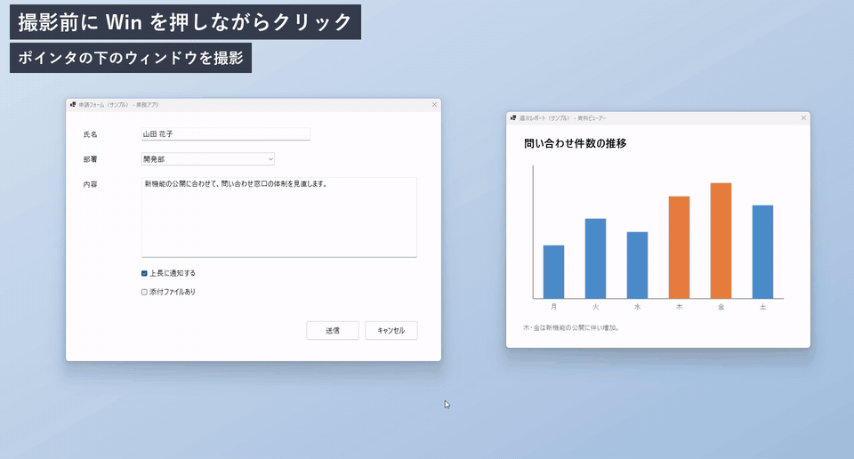
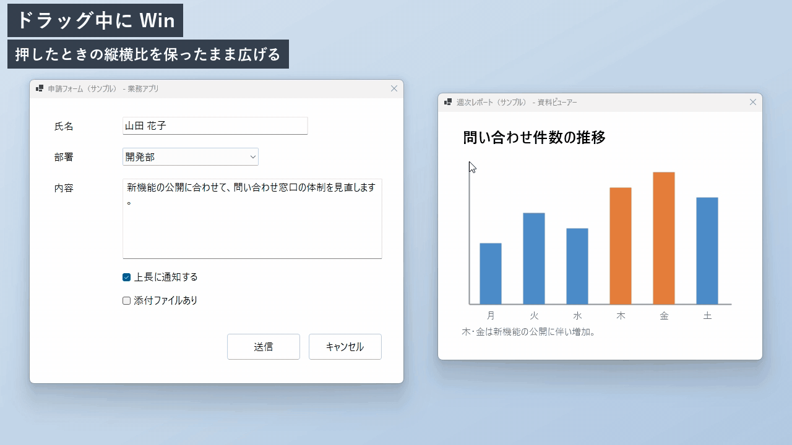
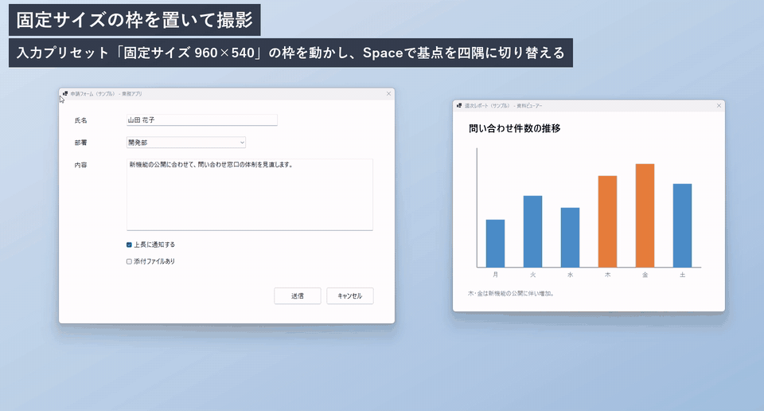

# SSCapture 操作風景動画

撮影中にCtrl・Shift・Alt・Winやマウスを使ったときの動きを、既定のキー割り当てで実機を操作して録画しました。

- 背景は録画用の架空の画面です。実在のアプリや作業中の画面ではありません。
- 左上は操作の名前と説明、左下のオレンジの帯は押しているキーとマウスボタンです。
- グリッド間隔とウィンドウスナップ距離は、動きが分かりやすいように100pxにしています（既定はどちらも20px）。設定の「基本」→「位置・寸法の補正」で変更できます。
- 複数のモニターが必要な操作（Shiftでモニターをまたぐ・移る操作）は含みません。
- キーの割り当ては設定の「ショートカット」で変更できます。一覧は[使い方の「起動とショートカット」](usage.md#起動とショートカット)にあります。

## 撮影範囲を決める前のキー

### 撮影前に Shift＋左クリック：ポインタのあるモニター全体を撮影

### 撮影前に Ctrl を押しながらクリック：ボタンや入力欄を1つだけ撮影

### 撮影前に Ctrl を押しながらホイール回転：撮影対象の余白を広げる

### 撮影前に Ctrl を押しながら左ドラッグ：通ったコントロールを1枚にまとめる

### 撮影前に Win を押しながらクリック：ポインタの下のウィンドウを撮影

### 撮影前に Win を押しながら左ドラッグ：通ったウィンドウを1枚にまとめる

## ドラッグ中のキー

### ドラッグ中に Win：押したときの縦横比を保つ

### ドラッグ中に Ctrl：起点を中心に四方へ広げる

### ドラッグ中に Ctrl＋Shift：起点を中心に、縦横比を保って広げる

### ドラッグ中に Alt＋Shift：高さを固定して横だけ変える

### ドラッグ中に Alt＋Ctrl：幅を固定して縦だけ変える

### ドラッグ中に Win＋Alt：幅と高さをグリッド間隔にそろえる

### Alt を押しながらドラッグ：ウィンドウやモニターの端に吸着させる

## そのほかの操作

### 拡大鏡で画素単位に合わせる：中クリックで表示し、矢印キーで1pxずつ動かす

### 固定サイズの枠を置いて撮影：入力プリセット「固定サイズ 960×540」

動画の作り直し方は[ビルド手順の「READMEの撮影」](DEVELOPERS_GUIDE.md#readmeの撮影)にあります。
