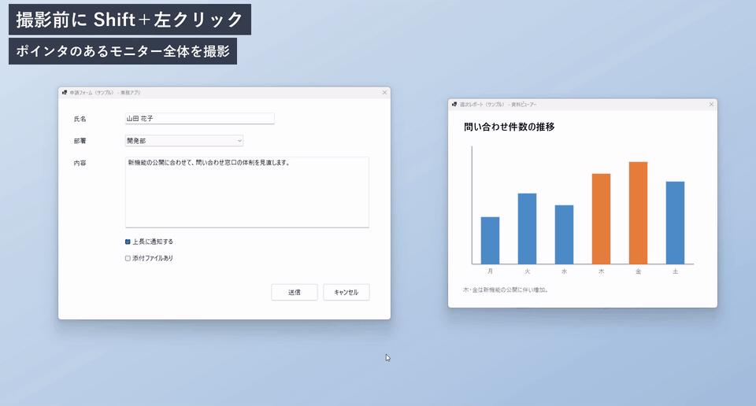
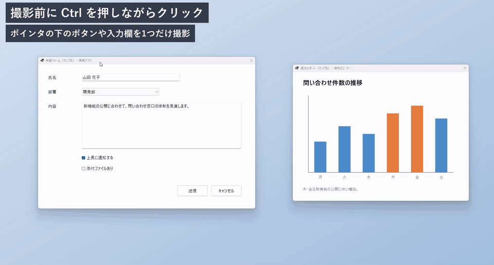
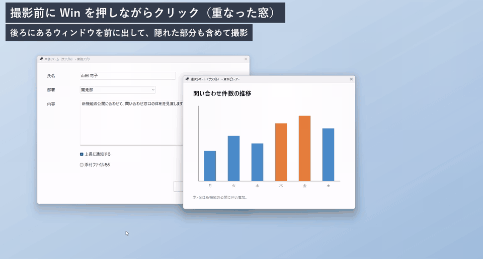
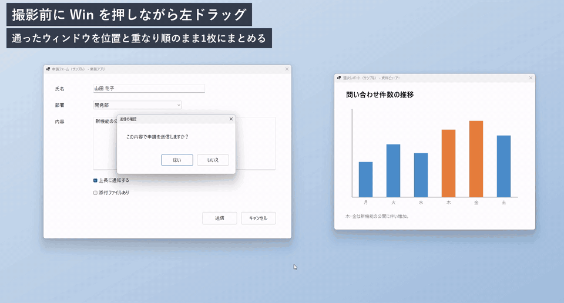
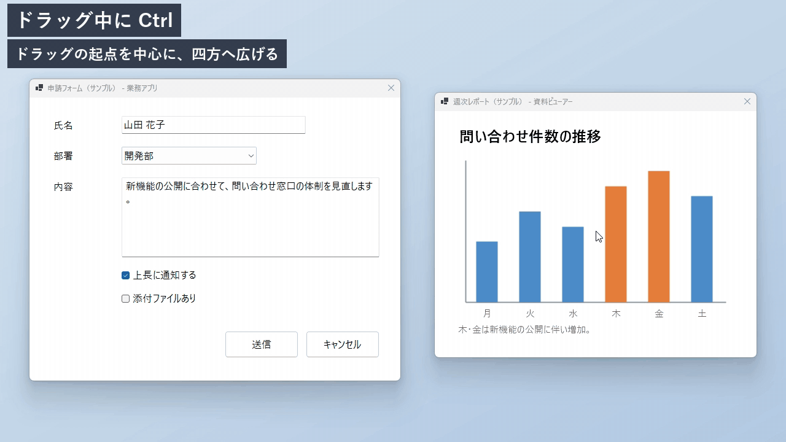
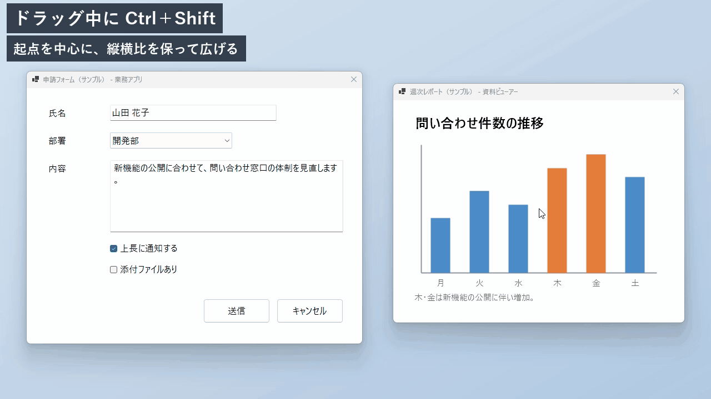
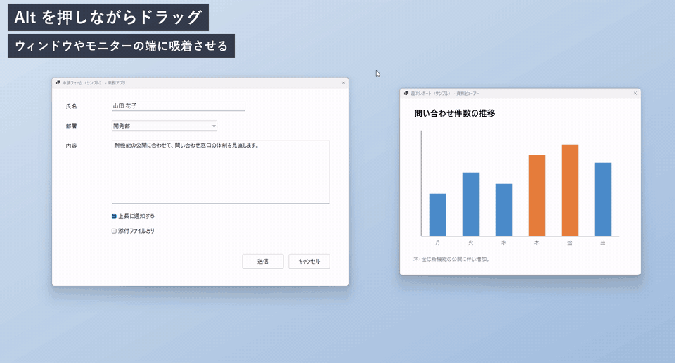

# SSCapture 操作風景動画

撮影中にCtrl・Shift・Alt・Winやマウスを使ったときの動きを、既定のキー割り当てで実機を操作して録画しました。

- 背景は録画用の架空の画面です。実在のアプリや作業中の画面ではありません。
- 左上は操作の名前と説明、左下のオレンジの帯は押しているキーとマウスボタンです。
- 動きが分かりやすいように、グリッド間隔を100px（既定20px）、拡大鏡の拡大倍率を20倍（既定10倍）にしています。グリッド間隔は設定の「基本」→「位置・寸法の補正」、拡大鏡は「基本」→「操作ガイド」で変更できます。
- 複数のモニターが必要な操作（Shiftでモニターをまたぐ・移る操作）は含みません。
- キーの割り当ては設定の「ショートカット」で変更できます。一覧は[使い方の「起動とショートカット」](usage.md#起動とショートカット)にあります。

## 撮影範囲を決める前のキー

### 撮影前に Shift＋左クリック：ポインタのあるモニター全体を撮影

### 撮影前に Ctrl を押しながらクリック：ボタンや入力欄を1つだけ撮影

### 撮影前に Ctrl を押しながらホイール回転：撮影対象の余白を広げる

### 撮影前に Ctrl を押しながら左ドラッグ：通ったコントロールを1枚にまとめる

### 撮影前に Win を押しながらクリック：手前のダイアログごとウィンドウを撮影

### 撮影前に Win を押しながらクリック：重なって後ろにあるウィンドウを前に出して撮影

### 撮影前に Win を押しながら左ドラッグ：通ったウィンドウを1枚にまとめる

## ドラッグ中のキー

### ドラッグ中に Win：押したときの縦横比を保つ

### ドラッグ中に Ctrl：起点を中心に四方へ広げる

### ドラッグ中に Ctrl＋Shift：起点を中心に、縦横比を保って広げる

### ドラッグ中に Alt＋Shift：高さを固定して横だけ変える

### ドラッグ中に Alt＋Ctrl：幅を固定して縦だけ変える

### ドラッグ中に Win＋Alt：幅と高さをグリッド間隔にそろえる

### Alt を押しながらドラッグ：ウィンドウの角に吸着させて、ぴったり囲う

### ウィンドウに吸着してから Alt＋Shift：ウィンドウの高さのまま、左側だけを撮影

### ウィンドウに吸着してから Alt＋Ctrl：ウィンドウの幅のまま、上側だけを撮影

## そのほかの操作

### 拡大鏡と十字キーで画素単位に合わせる

### 固定サイズの枠を置いて撮影：Spaceで基点を切り替える

動画の作り直し方は[ビルド手順の「READMEの撮影」](DEVELOPERS_GUIDE.md#readmeの撮影)にあります。
