# SSCapture 操作風景動画

撮影中にCtrl・Shift・Alt・Win・Space・Escやマウスを使ったときの動きと、拡大鏡・固定サイズ・スクロール撮影の操作を、既定のキー割り当てで実機を操作して録画しました。動画は種類ごとに折りたたんでいます。見出しをクリックすると開きます。

- 背景は録画用の架空の画面です。実在のアプリや作業中の画面ではありません。
- 掲載中のGIFは960×516です。新しい収録手順ではHD（1280×720）の範囲を等倍で録画します。録画範囲はモニターの左上で、スクロール撮影は右下です。
- 左上は操作の名前と説明、左下のオレンジの帯は押しているキーとマウスボタンです。
- 動画ではグリッド間隔を100px、拡大鏡を10×10ドット・20倍にしています。現在の初期値はグリッド間隔20px、拡大鏡20×20ドット・4倍です。グリッド間隔は設定の「基本」→「位置・寸法の補正」、拡大鏡は「基本」→「操作ガイド」で変更できます。
- 複数のモニターが必要な操作（Shiftでモニターをまたぐ・移る操作）は含みません。
- キーの割り当ては設定の「ショートカット」で変更できます。一覧は[使い方の「起動とショートカット」](usage.md#起動とショートカット)にあります。

<strong>基本の撮影：範囲・ウィンドウ・モニター（7本）</strong>

### 左ドラッグで囲う：Snipping Tool と同じ操作で範囲を撮影

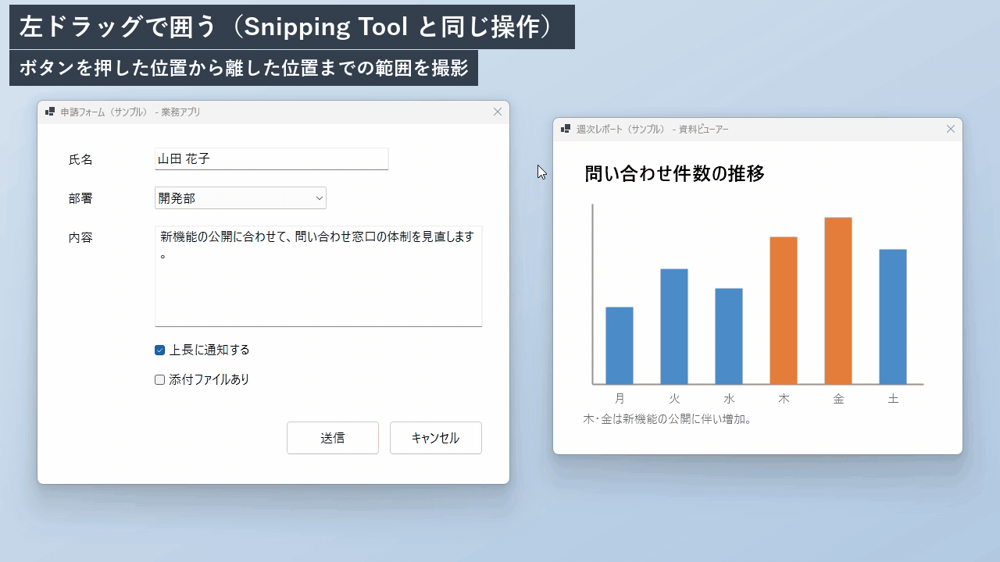

### ドラッグ中に右クリック／Esc：押している途中の範囲だけを取り消す

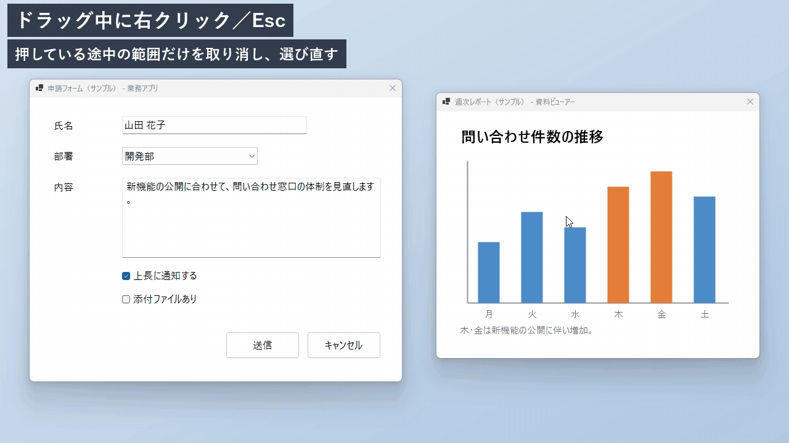

### 撮影前にクリック：ウィンドウを見えているままに撮影

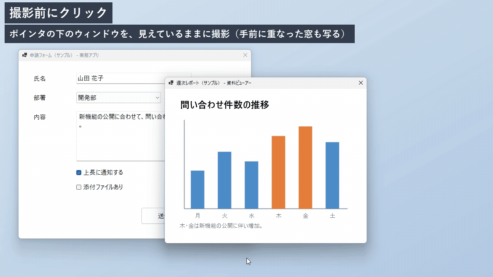

### 撮影前に Win を押しながらクリック：重なって後ろにあるウィンドウを前に出して撮影

### 撮影前に Win を押しながらクリック：手前のダイアログごとウィンドウを撮影

### 撮影前に Win を押しながら左ドラッグ：通ったウィンドウを1枚にまとめる

### 撮影前に Shift＋左クリック：ポインタのあるモニター全体を撮影

<strong>コントロールの撮影：Ctrl（3本）</strong>

### 撮影前に Ctrl を押しながらクリック：ボタンや入力欄を1つだけ撮影

### 撮影前に Ctrl を押しながら左ドラッグ：通ったコントロールを1枚にまとめる

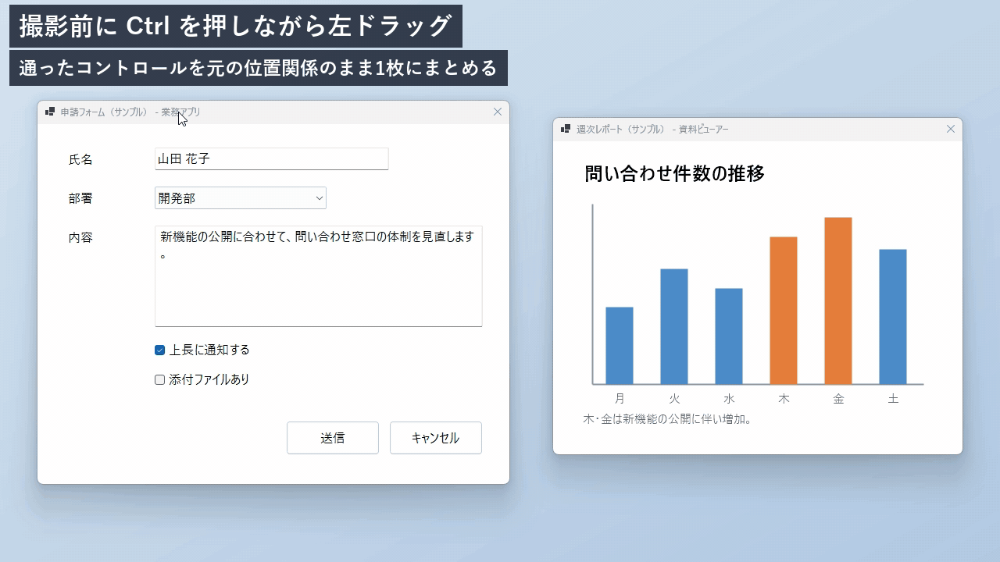

### 撮影前に Ctrl を押しながらホイール回転：撮影対象の余白を広げる

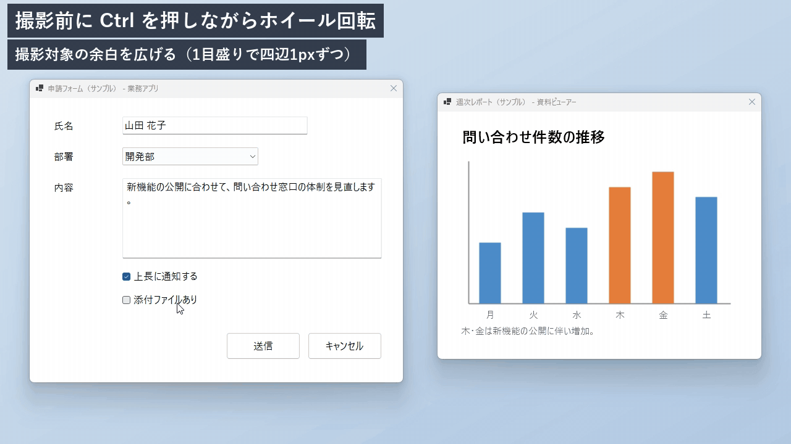

<strong>ドラッグ中のキー：Space・Win・Ctrl・Shift・Alt（7本）</strong>

### ドラッグ中に Space：範囲を保ったまま、反対側の角から調整する

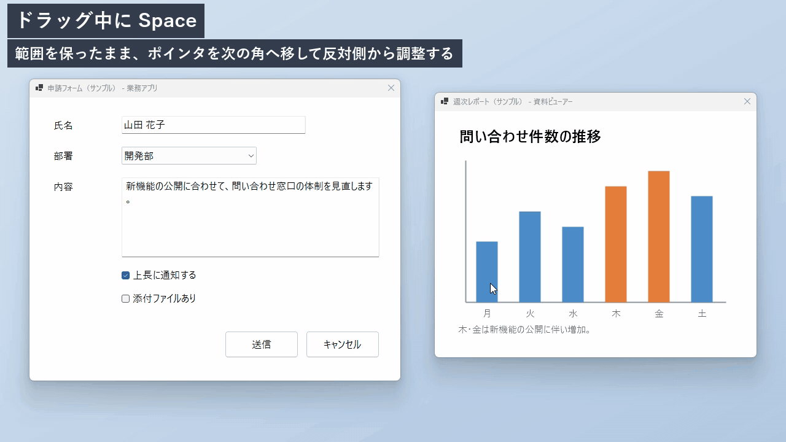

### ドラッグ中に Win：押したときの縦横比を保つ

### ドラッグ中に Ctrl：起点を中心に四方へ広げる

### ドラッグ中に Ctrl＋Shift：起点を中心に、縦横比を保って広げる

### ドラッグ中に Alt＋Shift：高さを固定して横だけ変える

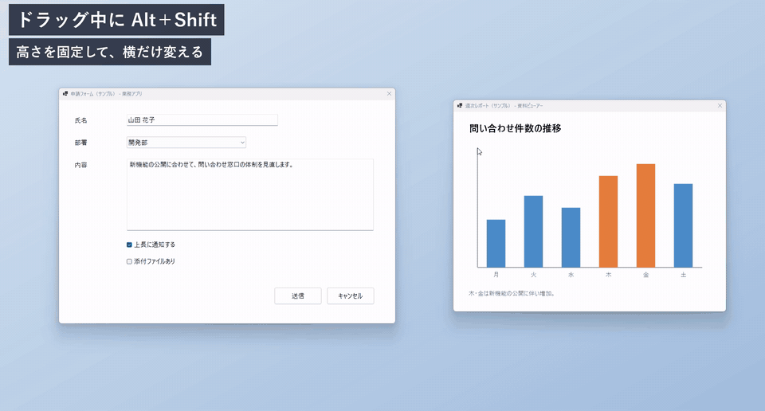

### ドラッグ中に Alt＋Ctrl：幅を固定して縦だけ変える

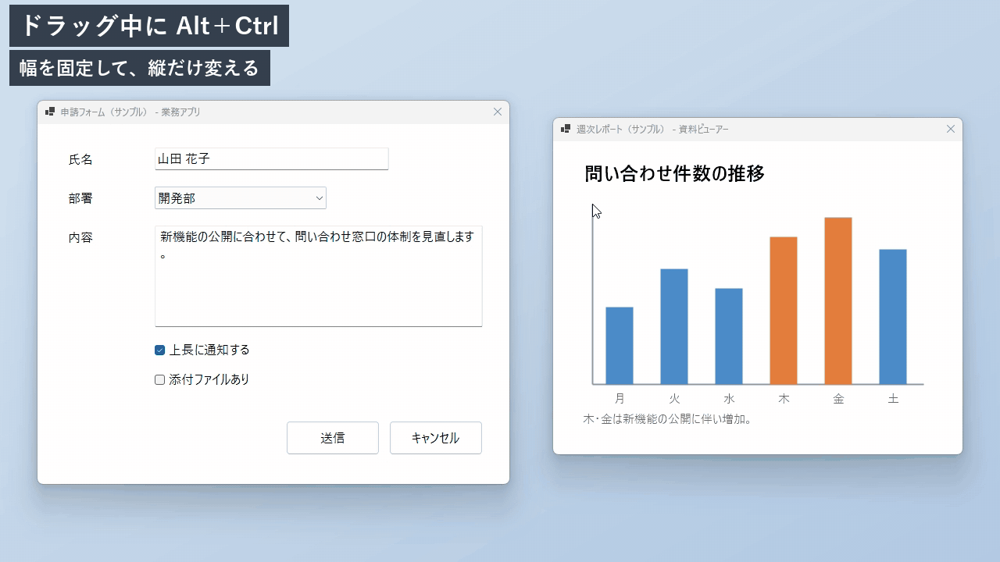

### ドラッグ中に Win＋Alt：幅と高さをグリッド間隔にそろえる

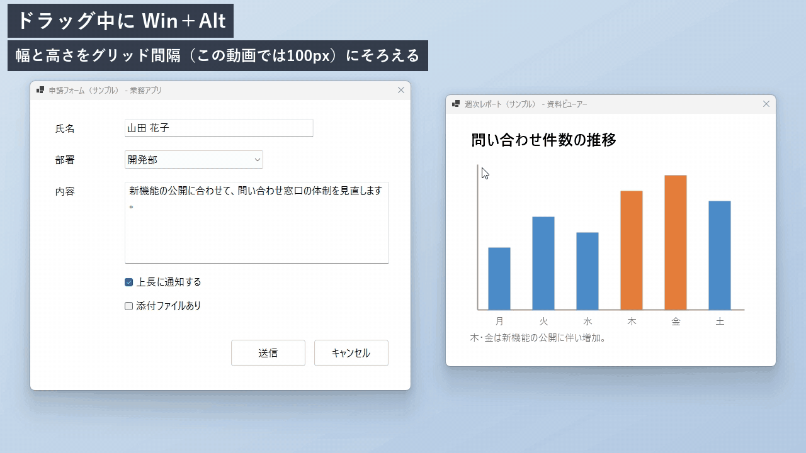

<strong>ウィンドウへの吸着：Alt（3本）</strong>

### Alt を押しながらドラッグ：ウィンドウの角に吸着させて、ぴったり囲う

### ウィンドウに吸着してから Alt＋Shift：ウィンドウの高さのまま、左側だけを撮影

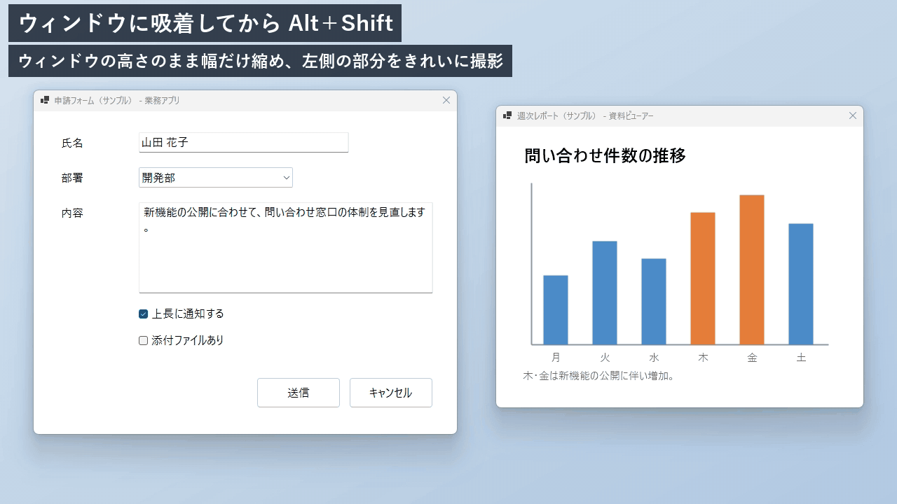

### ウィンドウに吸着してから Alt＋Ctrl：ウィンドウの幅のまま、上側だけを撮影

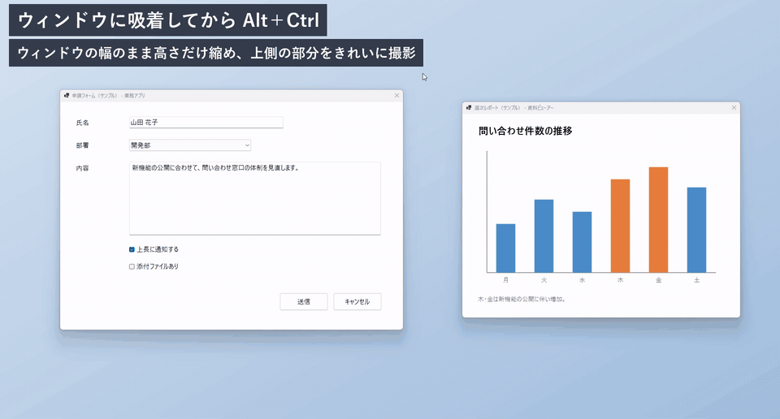

<strong>拡大鏡・固定サイズ・スクロール撮影（3本）</strong>

### 拡大鏡と十字キーで画素単位に合わせる

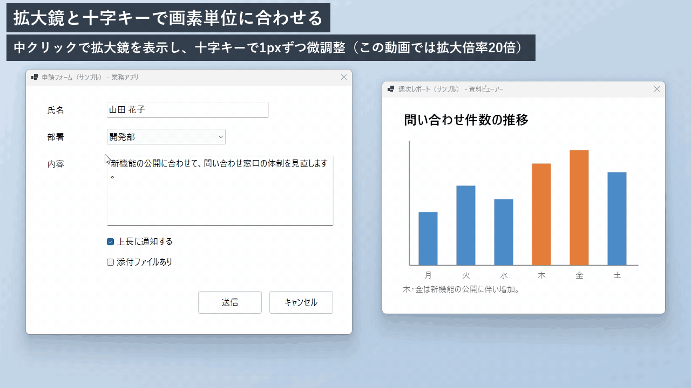

### 固定サイズの枠を置いて撮影：Spaceで基点を切り替える

### スクロール撮影：縦に長い内容を1枚にまとめる

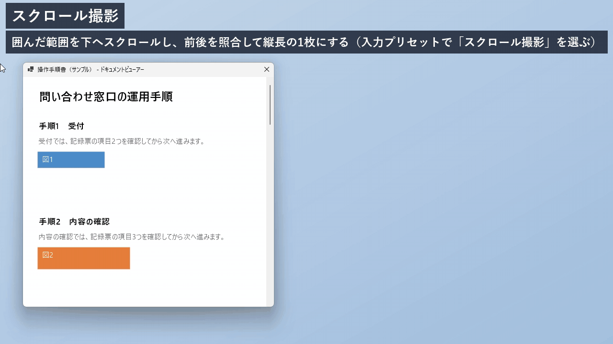

スクロール撮影の操作窓（合成済みの寸法と「撮影を確定」「取り消す」）は、画面取得から除外されるため録画には映りません。動画ではその位置を橙色の枠で示しています。手順は[使い方の「スクロール撮影」](usage.md#スクロール撮影)にあります。

動画の作り直し方は[ビルド手順の「READMEの撮影」](DEVELOPERS_GUIDE.md#readmeの撮影)にあります。
