# 設定画面一覧

トレイアイコンの「設定」、または引数なしでSSCaptureを起動すると開く設定画面の、すべてのページと内側のタブを示します。画像は新規設定の状態です。保存先などのパスは例の値（`C:\Users\user\…`）、モニターは1920×1080pxの2画面の例で表示しています。

設定画面の左の一覧でページを選びます。各ページの右下のボタンは次のとおりです。

| ボタン | 動作 |
| --- | --- |
| 適用 | そのページの変更を以後の撮影に使います。入力に問題がある場合は、画面下に理由を表示します。 |
| 戻す | まだ適用していない変更を取り消し、保存済みの設定に戻します。 |
| 初期設定に戻す | 表示中のページを初期値に戻します。ショートカットは表示中のタブだけが対象です。入力・出力プリセットと外部アプリは標準の登録を戻し、自分で追加した登録は残します。 |
| 閉じる | 設定画面を閉じます。適用していない変更は破棄します。アプリは常駐を続けます。 |

入力プリセットと出力プリセットは変更の確定時に保存します。外部アプリの既定指定と標準登録の復元も、それぞれのボタンで確定すると保存します。

## 基本

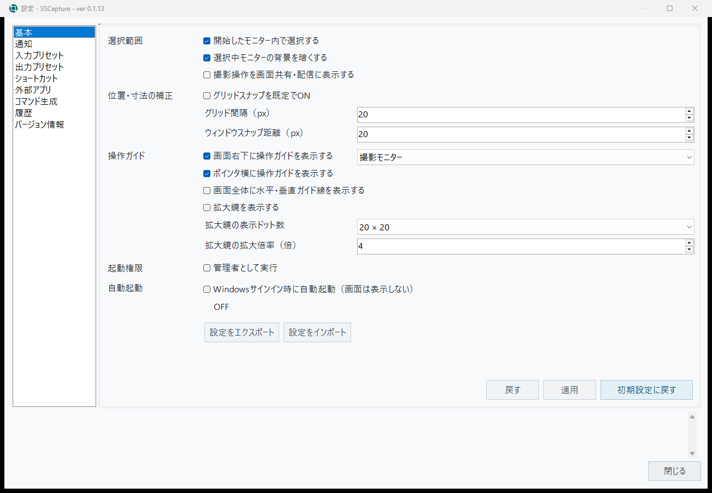

| 項目 | 内容 |
| --- | --- |
| 選択範囲 | 撮影を始めたモニターの中だけで選ぶか、選択中のモニターの背景を暗くするか、選択枠や操作ガイドを画面共有・配信にも表示するかを選びます。配信への表示の初期値はOFFです。[画面共有・配信への表示](usage.md#撮影操作を画面共有配信に表示する) |
| 位置・寸法の補正 | グリッドスナップを既定でONにするか、グリッドの間隔、ウィンドウの枠に吸い付く距離を指定します。どちらも初期値は20pxです。 |
| 操作ガイド | 画面右下とポインタ横の操作ガイド、矩形の全画面ガイド線、拡大鏡を個別に表示できます。全画面ガイド線は初期OFF、拡大鏡は20×20ドット・4倍が初期値です。[画素単位の選択](usage.md#画素単位で範囲やコントロールを選ぶ) |
| 起動権限 | 「管理者として実行」をONにして適用すると、「再起動」からWindowsの承認を経て管理者権限へ切り替えられます。初期値はOFFです。[管理者アプリで撮影キーを使う](usage.md#管理者アプリで撮影キーを使う) |
| 自動起動 | Windowsへのサインイン時に画面を出さずに起動するかを選び、右下の「適用」で確定します。初期値はOFFです。[サインイン時の起動](usage.md#サインイン時の起動) |
| 設定をエクスポート・インポート | 設定とプリセットをJSONファイルに書き出し、別のPCなどで読み込みます。[設定ファイルを別のPCで使う](usage.md#設定ファイルを別のpcで使う) |

## 通知

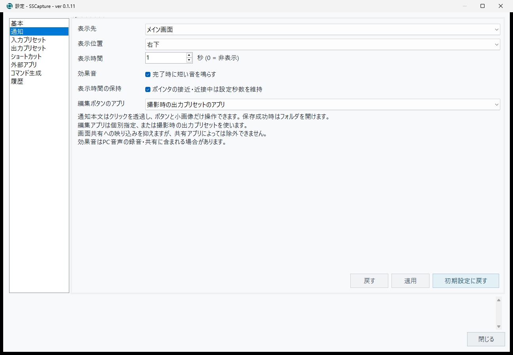

| 項目 | 内容 |
| --- | --- |
| 表示先・表示位置 | 撮影完了の通知を出すモニターと、その中の位置（8方位と中央）を選びます。初期値はメイン画面の右下です。配信への表示がONの撮影では、撮影したモニターに出します。 |
| 表示時間 | 通知を表示する秒数です。0にすると通知を出しません。 |
| 効果音 | 撮影完了時に短い音を鳴らします。通知を出さない設定でも鳴ります。 |
| 表示時間の保持 | ポインタが通知に近づいている間は、通知を消さずに残します。 |
| 編集ボタンのアプリ | 通知の「外部アプリで編集」で使うアプリです。別の画像用・動画用アプリが同名の場合は、候補名に用途が付きます。初期値は撮影時の出力プリセットのアプリです。 |

[完了表示と効果音](usage.md#完了表示と効果音)

## 入力プリセット

「どう撮るか」を登録します。左の一覧で選んだプリセットを右側で編集します。★が付いたものが既定です。新規設定では「囲った範囲」と、960×540・800×600・320×240pxの固定サイズの4件を用意します。

| 取得条件 | 座標・寸法 | 録画・音声 |
| --- | --- | --- |
| 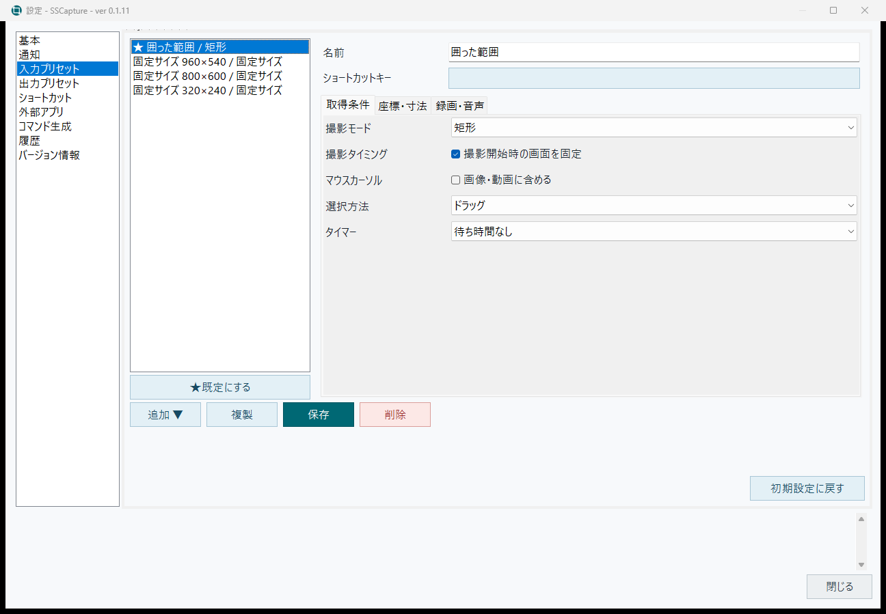 | 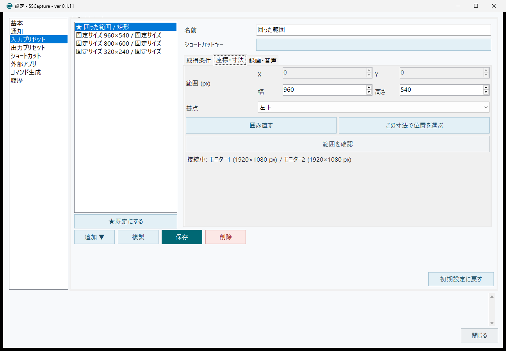 | 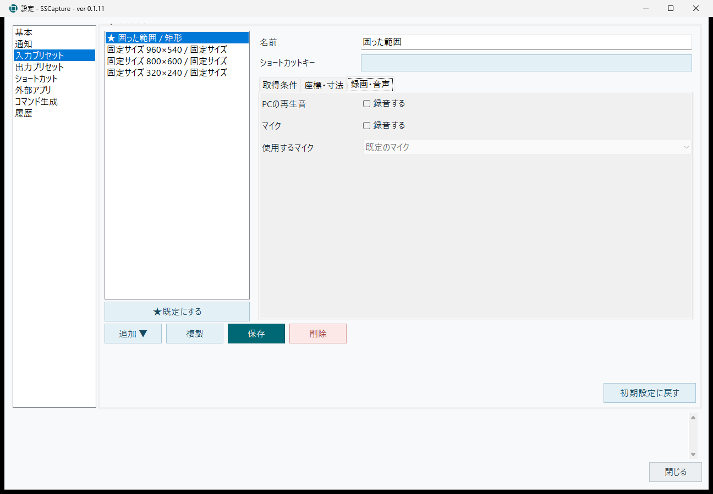 |

| タブ | 内容 |
| --- | --- |
| 取得条件 | 撮影モード（矩形・ウィンドウ・全画面・自由形状・固定サイズ・固定位置とサイズ・スクロール）、撮影開始時の画面を固定するか、マウスカーソルを含めるか、矩形の選び方（ドラッグ・2回のクリック）、[撮影開始タイマー](usage.md#撮影開始タイマー)を設定します。 |
| 座標・寸法 | 固定サイズの幅・高さと基点、固定位置の座標を指定します。「囲み直す」「この寸法で位置を選ぶ」で実際の画面から範囲を指定できます。 |
| 録画・音声 | 録画のときにPCの再生音とマイクを録音するか、使うマイクを選びます。 |

「追加▼」の「前回の撮影範囲」で、起動中に最後に撮った範囲を固定位置として登録できます。[既定プリセットと今回だけの変更](usage.md#既定プリセットと今回だけの変更)・[同じ範囲・固定サイズ・撮影履歴](usage.md#同じ範囲固定サイズ撮影履歴)

## 出力プリセット

「撮った後にどうするか」を登録します。新規設定では「クリップボード」「ファイル保存」「クリップボード＋ファイル」「OCR（文字列）」「OCR（表）」の5件を用意し、「クリップボード」が既定です。

| 出力・画像 | 保存・OCR | 撮影情報 |
| --- | --- | --- |
| 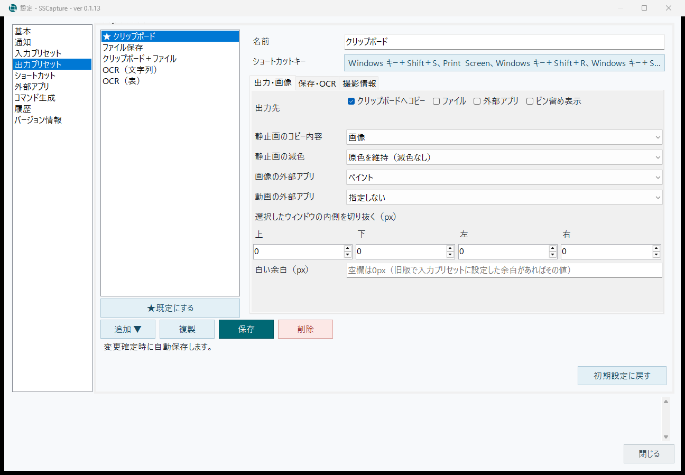 | 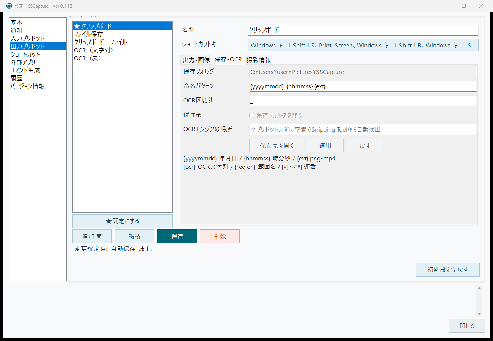 | 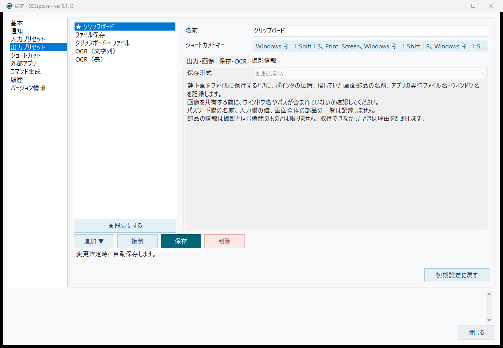 |

| タブ | 内容 |
| --- | --- |
| 出力・画像 | 出力先（クリップボード・ファイル・外部アプリ・ピン留め表示、複数可）、静止画のコピー内容（画像・テキスト・表・ファイルパス）、静止画の減色、画像・動画を渡す外部アプリ、選んだウィンドウの内側を上下左右で切り抜く量、白い余白を指定します。[撮影画像の白い余白](usage.md#撮影画像の白い余白) |
| 保存・OCR | 保存フォルダ、ファイル名の命名パターン、OCRで読んだ文字列の区切り、保存後にフォルダを開くか、OCRエンジンの場所（すべての出力プリセットで共通）を指定します。[ファイル名とOCR](usage.md#ファイル名とocr) |
| 撮影情報 | 静止画をファイル保存するときに、座標・UIの情報・アプリ情報をPNG内（XMP）や別のJSONに記録するかを選びます。初期値は記録しないです。ウィンドウ名やパスを含むため、共有前に内容を確認してください。[撮影情報の記録](usage.md#撮影情報の記録) |

## ショートカット

撮影の開始キーと、撮影中に使うキー・クリックの割り当てを4つのタブで設定します。[起動とショートカット](usage.md#起動とショートカット)

### PC作業中

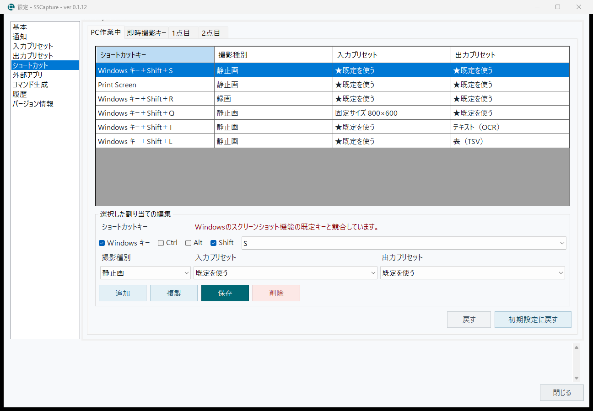

撮影を始めるキーの一覧です。1行ごとに、キー・静止画か録画か・入力プリセット・出力プリセットを組み合わせます。表の「★既定を使う」は、撮影した時点の既定を使います。新規設定では、Windowsキー＋Shift＋SとPrint Screenで静止画、Windowsキー＋Shift＋Rで録画、Windowsキー＋Shift＋Qで800×600pxの固定サイズを撮ります。Windowsキー＋Shift＋Tでテキスト、Windowsキー＋Shift＋Lで表をコピーします。割り当てを選ぶと、既知の競合がキーのラベル右に赤字で表示されます。[プリセット撮影のショートカット](usage.md#プリセット撮影のショートカット)

### 即時撮影キー

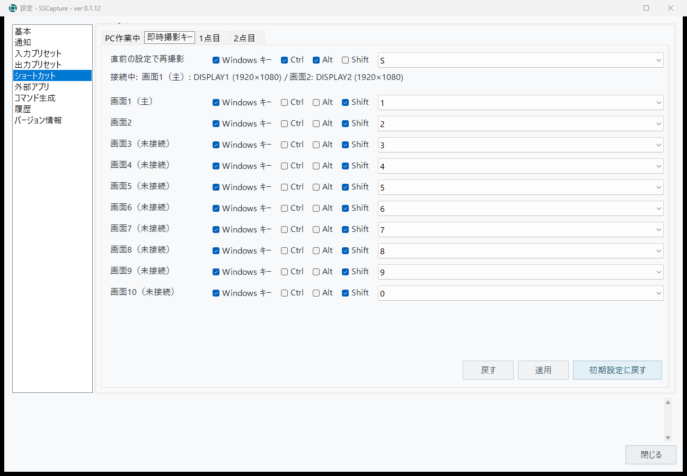

「直前の設定で再撮影」のキー（初期値はWindowsキー＋Ctrl＋Shift＋S）と、選択画面を出さずに画面1〜10の全体を撮るキー（初期値はWindowsキー＋Shift＋数字）を設定します。[暗転しない即時撮影](usage.md#暗転しない即時撮影)・[直前の設定で再撮影](usage.md#直前の設定で再撮影)

### 1点目

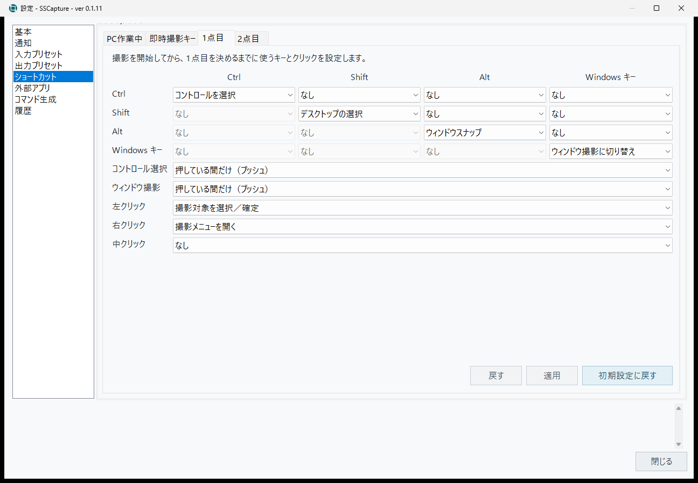

撮影を始めてから、範囲の1点目を決めるまでに使う修飾キーとクリックの割り当てです。表の行と列の組み合わせで、2つのキーを同時に押したときの動作を指定します。初期値では、Ctrlでコントロールの選択、Shiftでデスクトップ（モニター全体）の選択、Altでウィンドウスナップ、Windowsキーでウィンドウ撮影への切り替えです。コントロール選択とウィンドウ撮影は、押している間だけ有効にするか、押すたびに切り替えるかを選べます。

### 2点目

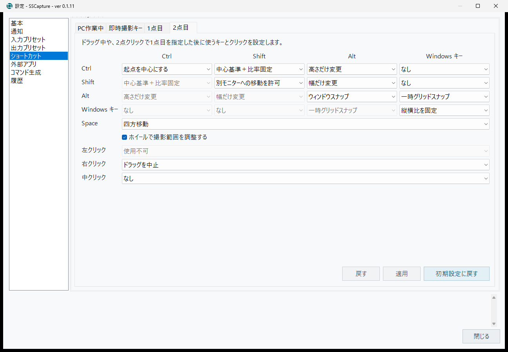

ドラッグ中、または2回のクリックで1点目を指定した後に使う割り当てです。起点を中心にする、比率の固定、別モニターへの移動の許可、上下・左右だけの変更、スナップなどを修飾キーに割り当てます。Spaceで切り替える基点の順序（対角・四方・四方と中心）と、ホイールで撮影範囲を調整するかも選びます。

## 外部アプリ

撮影した画像・動画を渡す編集アプリを登録します。新規設定ではペイントを画像用に登録します。

| 画像 | 動画 |
| --- | --- |
| 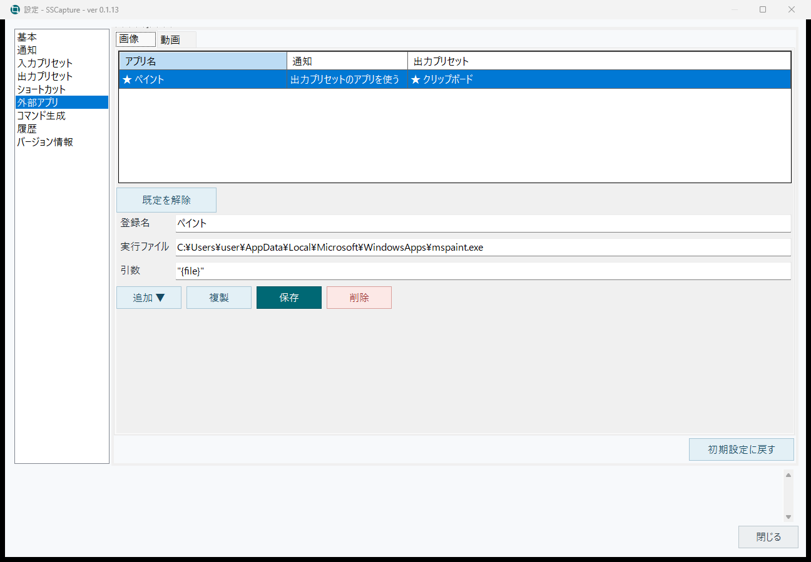 | 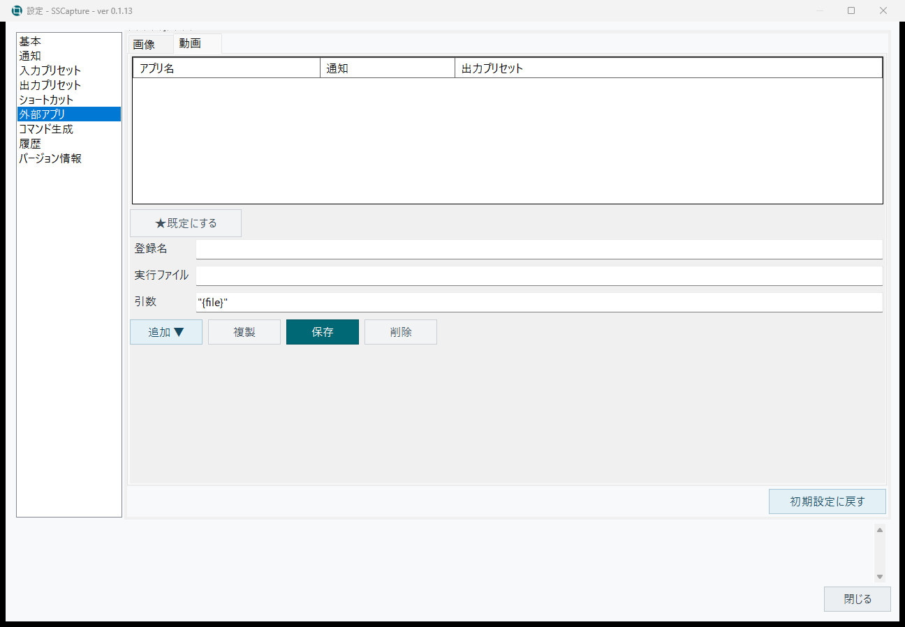 |

| 項目 | 内容 |
| --- | --- |
| 一覧 | 既定の出力プリセットが使うアプリには★が付きます。登録したアプリと、それを使う出力プリセットを示します。「通知」列は、通知の編集ボタンが開くアプリを「通知用に指定」または「出力プリセットのアプリを使う」で示します。 |
| ★既定にする／既定を解除 | 既定の出力プリセットが使う画像・動画アプリの指定や解除を、その場で保存します。 |
| 初期設定に戻す | 確認後、標準の外部アプリを復元して保存します。自作の登録と既定の指定は引き継ぎます。 |
| 登録名・実行ファイル・引数 | 表示名、実行ファイルのパス、渡す引数です。引数の `{file}` は撮影したファイルの完全パスに置き換わります。「追加▼」からペイント・Paint.NET・Snipping Toolなどを選んで登録できます。 |

[外部アプリの初期登録と保存](usage.md#外部アプリの初期登録と保存)

## コマンド生成

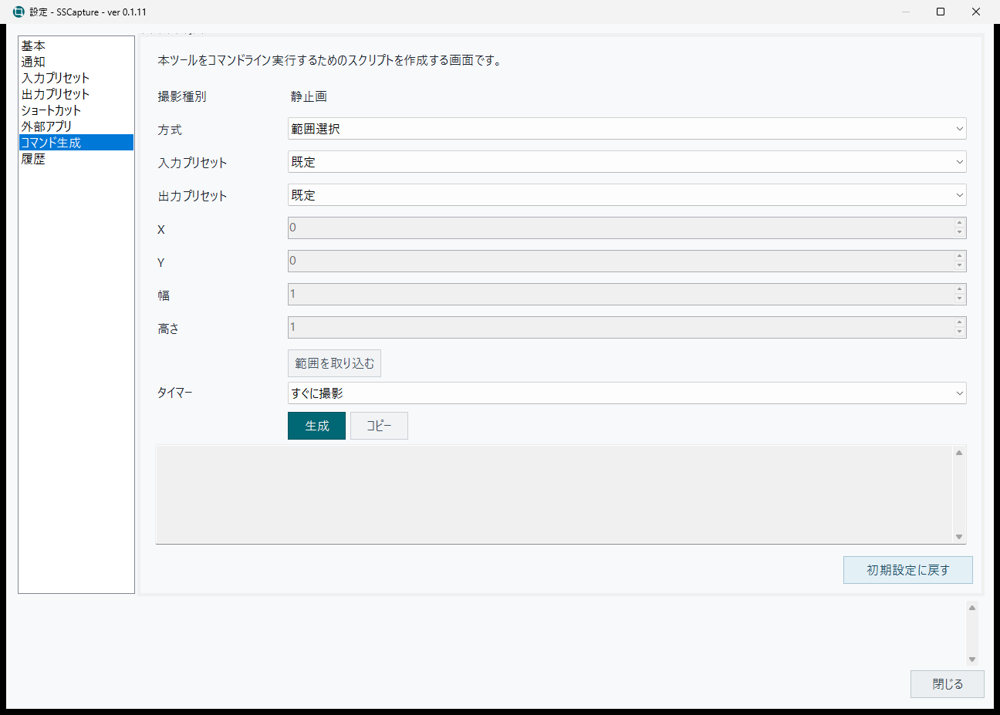

選んだ条件で撮影するPowerShellのコマンドを作ります。方式（範囲選択・固定範囲・入力プリセットに従う）、入出力プリセット、固定範囲の座標と寸法、タイマー（すぐに撮影・指定秒数後・指定日時・定期撮影）を選び、「生成」「コピー」を押します。生成・コピーでは撮影も設定の保存もしません。[コマンド生成](usage.md#コマンド生成)・[タイマー撮影](usage.md#タイマー撮影)・[コマンドライン](cli.md)

## 履歴

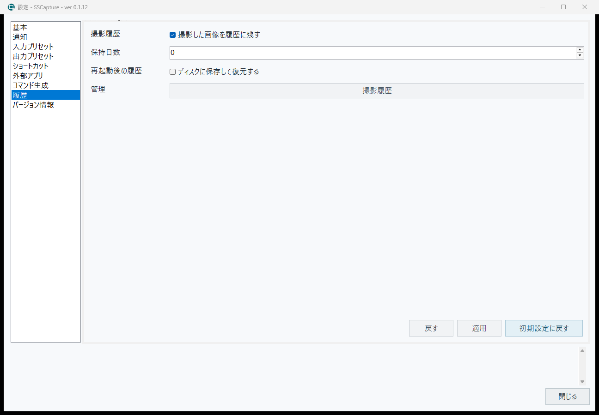

「撮影した画像を履歴に残す」をONにすると、「撮影履歴」で一覧を開けます。「保持日数」は0で期限なしです。「ディスクに保存して復元する」をONにすると、クリップボードだけに出力した画像も再起動後に使えます。この項目の初期設定はOFFです。履歴の保持をOFFにすると一覧と履歴用画像を消去します。[同じ範囲・固定サイズ・撮影履歴](usage.md#同じ範囲固定サイズ撮影履歴)

## 画像の作り直し

画面を変更したときは、通常テストをビルドした後に次のコマンドで画像を作り直します。新規設定の初期値を使い、このPCのユーザーフォルダ・モニター・マイク・自動起動の登録は例の値に差し替えます。設定画面のウィンドウだけを画像にし、デスクトップや他のウィンドウは取得しません。実行中は設定画面が数秒間表示されます。

```powershell
pwsh -File scripts/test.ps1 -Suite Preset
.tools/dotnet/dotnet.exe tests/SSCapture.Tests/bin/Release/net10.0-windows10.0.19041.0/SSCapture.Tests.dll --settings-gallery docs/images/settings
```

作り直した後は、画像にこのPCのユーザー名・モニター名・マイク名などが写っていないことを確認してください。
