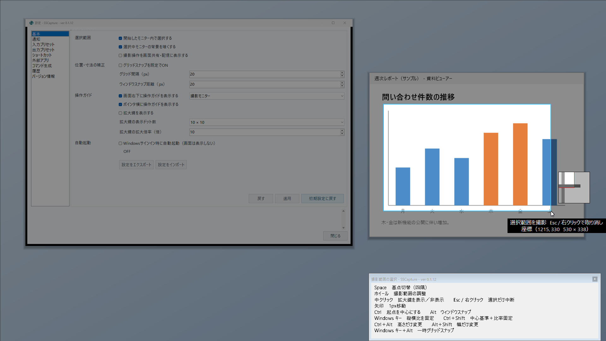
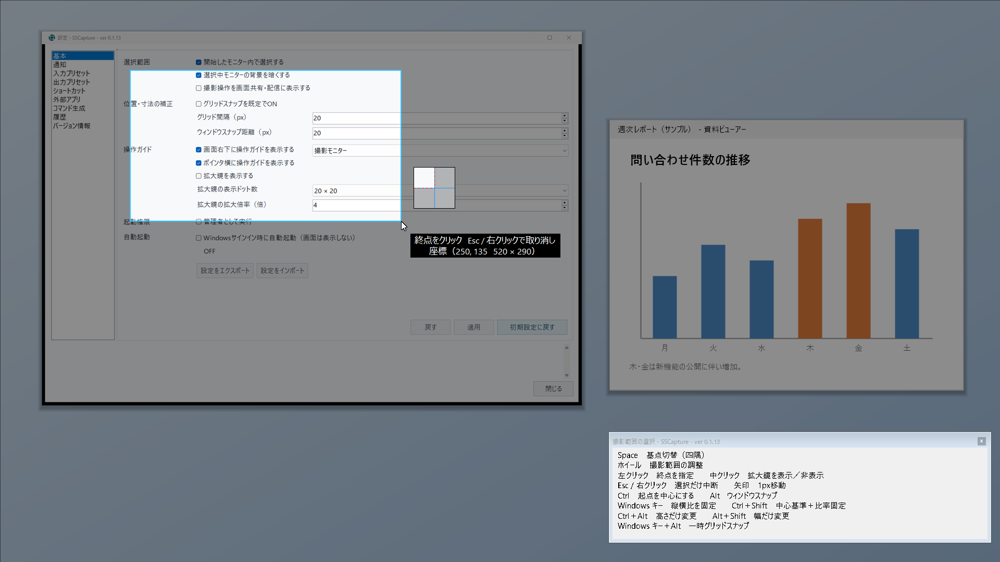
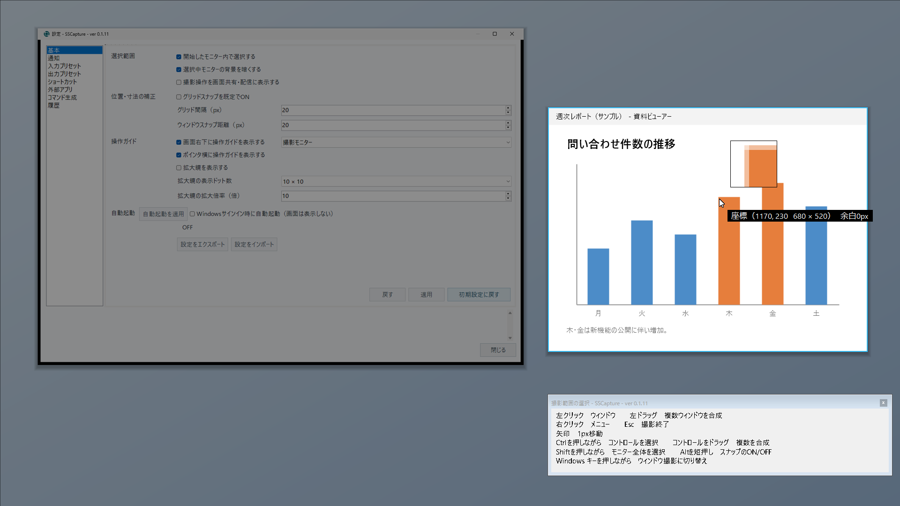
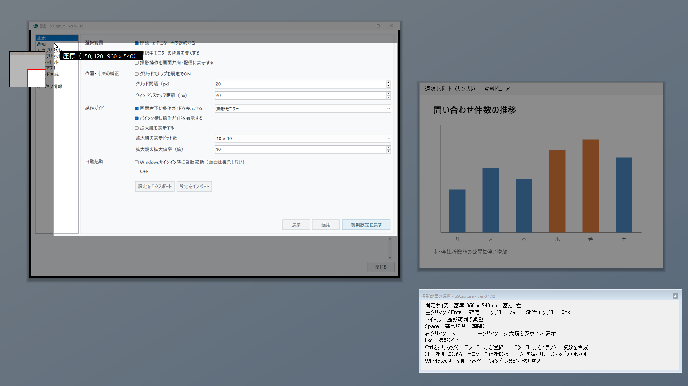
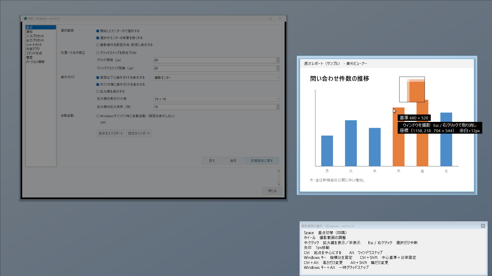

# SSCaptureの使い方

Windows 11用の常駐スクリーンショット・領域録画ツールです。クリップボード・ファイル保存・外部アプリ・静止画のピン留めを個別にON/OFFできます。既定はクリップボードだけONです。汎用画像編集画面は持たず、ピン留めした画像へ注釈を付けられます。

## 最初の一枚を撮る

1. スタートメニューからSSCaptureを起動します。設定画面を閉じても、タスクトレイで撮影を受け付けます。
2. **Win＋Shift＋S** を押し、キーを離してから、撮りたい範囲を左ドラッグします。通常の矩形選択では左ボタンを離すと撮影します。やめる場合は **Esc** を押します。
3. 撮影先が既定の「クリップボード」なら、貼り付けたいアプリで **Ctrl＋V** を押します。PNGも残す場合は、撮影中の右クリック →「出力プリセット」→「クリップボード＋ファイル」を選んでから撮影します。

以降のキーは新規設定での既定です。変更した場合は設定の「ショートカット」にある「PC作業中」と「即時撮影キー」で割り当てを確認できます。設定を開くにはトレイのSSCaptureアイコンをダブルクリックします。[起動とショートカット](#起動とショートカット)

## 撮影方法の選び方

| 撮りたい内容 | 選択中の操作 | 結果 |
| --- | --- | --- |
| 画面の任意の範囲 | 左ドラッグ | 画面で見えている内容を矩形で撮影 |
| ウィンドウ枠内に見えている画面 | 囲うモードで、対象の上で左クリック | 枠内に重なっている別のウィンドウやメニューも含めて撮影 |
| 対象ウィンドウの映像 | Winを押したまま、プレビューした対象を左クリック | Windows Graphics Capture（WGC）で取得。手前に見えている同じアプリの所有ウィンドウも対象 |
| 選んだ複数のウィンドウ | ウィンドウ撮影で、撮りたいウィンドウの上を左ドラッグで通過 | 通過したウィンドウを位置と重なり順に沿って合成 |
| モニター全体 | Shiftを押しながら対象モニターを左クリック。複数枚ならShiftを押してから左ドラッグで各モニターへ移動 | 通過したモニターを現在の配置で合成 |
| 一定の幅と高さ | 「入力プリセット」で固定サイズを選び、枠を置いて左クリック | 指定した物理ピクセル寸法で撮影。Spaceでポインタに合わせる基点を変更 |
| 表示領域より長い内容 | スクロール撮影で領域を囲み、対象をゆっくり下へスクロール | 重なりを照合して1枚の静止画に合成 |
| 暗転や選択画面を出さずにモニター全体 | 作業中にWin＋Shift＋数字 | 指定モニターを即時撮影。1は主画面 |

矩形でモニターをまたぐには、左ドラッグ中にShiftを押しながら境界を越えます。この撮影の間は、Shiftを離しても複数のモニターを選択できます。開始モニターの制限や各キーの割り当ては設定で変更できます。[撮影中の右クリックメニュー](#撮影中の右クリックメニュー)・[即時撮影](#暗転しない即時撮影)

## 撮影中の画面



入力プリセットの「撮影開始時の画面を固定」がONの場合、撮影を開始した時点の画面を固定して範囲を選びます。上は、1点目を決めてドラッグしている途中の画面です。

- 「選択中モニターの背景を暗くする」がONの場合、選択範囲の外側を暗くします。
- ポインタ横に、いまの操作と取り消し方、範囲の左上の座標と幅・高さを表示します。
- 拡大鏡で、ポインタ付近の画素と撮影範囲の境界（赤線）を確かめられます。
- 画面右下の操作ガイドに、いま使えるキー（Spaceで基点の切り替え、ホイールで範囲の調整など）を表示します。

| 2回のクリックで終点を待つ | ウィンドウを選ぶ | 固定サイズの枠を置く |
| --- | --- | --- |
|  |  |  |

画像は、架空のデスクトップで撮影したものです。ポインタ横の操作ガイドと画面右下の操作ガイドは初期設定でON、拡大鏡は初期設定でOFFで、設定の「基本」→「操作ガイド」で切り替えられます。[設定画面一覧](settings.md)

左ボタンを押したままホイールで拡張した例です。実線がウィンドウ枠、破線が取得する範囲です。



## 修飾キーの操作の動画

撮影中にCtrl・Shift・Alt・Winを押したときの動きや、拡大鏡・固定サイズの操作は、[操作風景動画](operation-videos.md)のページにまとめています。

## 用途別の操作例

### 開いたメニューを撮る

1. 使う「入力プリセット」の「撮影開始時の画面を固定」をONにします。初期の「囲った範囲」ではONです。
2. スタートメニューや右クリックメニューを開いたまま **Win＋Shift＋S** を押します。
3. 表示された画面で、メニューを含めたい範囲を左ドラッグします。

### 同じ範囲を繰り返し撮る

| 次に欲しいもの | 操作 |
| --- | --- |
| 同じ場所や対象の、いまの画像（余白・減色・出力先も同じ） | トレイの「直前の設定で再撮影」。直前に成功した撮影の対象と入出力条件を使います。専用キーは設定の「ショートカット」→「即時撮影キー」→「直前の設定で再撮影」で割り当てられます。 |
| すでに撮った画像 | 設定の「履歴」で「メモリーに保持する」をONにしておき、「撮影履歴」から「再コピー」を使います。 |
| いつも同じ位置・寸法で撮った画像 | 矩形か固定サイズで撮影してから、「入力プリセット」→「追加▼」→「前回の撮影範囲」で登録します。登録した範囲はアプリ終了後も使えます。 |

ウィンドウ・モニターの追跡はアプリの起動中に使えます。閉じたウィンドウや切断したモニターを識別できない場合は、対象を選び直してください。[固定サイズ・撮影履歴](#同じ範囲固定サイズ撮影履歴)・[直前の設定で再撮影](#直前の設定で再撮影)

### 資料に貼りながら画像ファイルも残す

1. 「出力プリセット」で「クリップボード＋ファイル」を選び、「保存・OCR」で保存先と命名パターンを確認します。今回だけ使う場合は撮影中の右クリックから選びます。
2. 撮影後、資料へ **Ctrl＋V** で貼り付けます。元のPNGを開く場合は通知の「フォルダを開く」を使います。
3. 別フォルダにも画像を置く場合は、通知の小画像を **Ctrlを押しながら** ドラッグします。保存済み画像をCtrlなしでフォルダにドロップすると、元のファイルが移動します。

PowerPointなどファイルのドロップを扱えるアプリにも渡せます。Excelへの直接ドロップには、画像受信に対応したOfficeAssistを使います。編集だけ始める場合は、通知の小画像をダブルクリックします。[通知の操作](#完了表示と効果音)・[出力プリセット](#既定プリセットと今回だけの変更)

### 画像を画面に残して見比べる

1. 「出力プリセット」で「ピン留め表示」をONにして撮影します。
2. 画像を左ドラッグで移動します。別の撮影画像も同じ方法で追加できます。
3. **Ctrl＋ドラッグ** で線を描き、**Ctrl＋Z** で戻します。書き込みを含めて残す場合は **Ctrl＋S** で出力プリセットのフォルダへ保存します。

[ペン・図形・文字と回転の操作](#静止画のピン留め)

### 操作手順を動画で残す

1. 録画の準備を済ませ、撮影中に使う出力プリセットで「ファイル」がONになっていることを確認します。MP4の保存先は「保存・OCR」で指定します。
2. **Win＋Shift＋R** を押して領域を選びます。「PC音」「マイク」を必要に応じて切り替え、「開始」を押します。
3. 「停止」または **Win＋Shift＋R** で確定します。「一時停止」中の時間は完成動画から省かれます。

[録画の準備](#録画の準備)・[録画と音声の操作](#録画と音声の操作)

### 共有用と調査用の画像を使い分ける

共有用の画像に白い余白が必要なら、出力プリセットの「白い余白（px）」を指定します。原色・8ビット（256色）・4ビット（16色）は出力プリセットの「静止画の減色」で選べます。調査用には、ファイル保存を有効にした上で「撮影情報」をPNG内XMPまたは別JSONに記録できます。ウィンドウ名やアプリのパスなどを含むことがあるため、共有前に確認してください。[白い余白](#撮影画像の白い余白)・[撮影情報](#撮影情報の記録)・[ファイル名とOCR](#ファイル名とocr)

## スクロール撮影

1. 「入力プリセット」→「取得条件」で撮影モードを「スクロール撮影」にしたプリセットを作成します。静止画撮影を開始した後、右クリックの「今回だけ入力を変更」→「撮影モード」からも選べます。
2. 縦にスクロールする部分を囲みます。固定ヘッダーやスクロールバー、別のウィンドウを外しておくと、前後の画面を照合しやすくなります。
3. 選んだ領域にポインタを置き、少しずつ下へスクロールします。操作窓に合成済みの寸法が表示されます。
4. 「撮影を確定」で1枚の静止画として出力します。「取り消す」またはEscで中止できます。

重なりを特定できないときは、少し戻してからゆっくりスクロールしてください。末端で同じ画面が続いても画像の寸法は変わりません。白い余白を含めて各辺32768px・合計1億画素の上限に達したときは、収集済みの範囲を確定できます。直前の設定で再撮影すると、元の領域でスクロールの収集から始めます。

## 静止画のピン留め

「出力プリセット」で「ピン留め表示」をONにすると、撮影画像を撮影位置へ枠なし・常に最前面の窓として表示します。複数枚を同時に置け、コピー・保存・外部アプリ出力とも併用できます。表示は撮影時の静止画で、元画面の変化には追従しません。白余白がある場合も元の画素が撮影座標に合う位置へ配置します。録画には適用しません。

| 操作 | 動作 |
| --- | --- |
| 左ドラッグ | 窓を移動 |
| Ctrl＋ドラッグ | ペン/選択中の図形を描画。初期は赤・3物理px |
| Ctrl＋Shift＋ドラッグ | 水平・垂直の直線 |
| Shift＋ドラッグ | 画像内のコピー範囲を選択 |
| Ctrl＋C | 選択範囲、未選択なら全体を描画込みでコピー |
| Ctrl＋S | 描画込みの全体画像を出力プリセットのフォルダ・命名パターンで保存 |
| Ctrl＋Z / Ctrl＋Y | 描画・回転・全消去を戻す/やり直す |
| L / R | 左/右へ90度回転。描画も一緒に回転し、範囲選択は解除 |
| ホイール | 表示倍率を変更。元の画素数は変更しない |
| Ctrl＋ホイール | ペンの太さを1～128物理pxで変更 |
| G / B / Y / O / P | 緑/青/黄/橙/ピンクへ変更。Shift併用で蛍光ペン |
| T | 文字入力。Enterで確定、Shift＋Enterで改行、Escで入力を取り消す |
| E | 注釈を全消去。元画像は残り、Ctrl＋Zで取り消し可能 |
| Esc | コピー範囲を解除。窓は閉じない |
| Ctrl＋W | 操作中の窓を閉じる |

右クリックの「ペン」から自由線・直線・矩形・楕円・矢印・文字、色、太さ、蛍光ペンを選べます。Rは回転を優先するため、通常の赤ペンはこのメニューから選びます。Shift＋Rは赤い蛍光ペンです。文字入力中は色切替キーを文字として扱います。「倍率100％・撮影位置へ戻す」で表示を戻せます。

Ctrl＋Sでは保存ダイアログを出しません。出力プリセットのファイル保存がOFFでも、ピン留めがONなら保存先・命名欄を設定できます。余白を二重追加せず、回転/注釈後の画像を保存します。編集後の画像へ元のUIA/撮影座標を誤って付けないため、この保存では撮影情報を付け直しません。必要なら元の撮影時のファイル出力で撮影情報を記録してください。

複数の窓はトレイの「すべてのピン留めを一時非表示」/「すべてのピン留めを再表示」でまとめて隠せます。窓や注釈はアプリ起動中だけ保持し、閉じる/アプリ終了で破棄します。必要な画像は先にコピーまたは保存してください。

## 撮影開始タイマー

- 「設定」→「入力プリセット」→「取得条件」→「タイマー」で「待ち時間なし」「3秒遅延」「5秒遅延」「10秒遅延」を設定できます。既定は「待ち時間なし」です。
- タイマーを設定したプリセットで静止画撮影を始めると、待ち時間の後、その時点の画面で範囲選択を開始します。登録済みの固定位置を即時撮影する操作では、待ち時間後にその位置を撮ります。
- 撮影中の右クリック →「タイマー」で秒数を選ぶと、選択画面が閉じます。待っている間に撮影対象を準備してください。待ち時間後に入力・出力の一時設定を引き継いで選択画面を開きます。描きかけの範囲は選び直します。「待ち時間なし」を選ぶと、現在の選択に戻ります。右クリックで選んだ秒数は保存しません。

## タイマー撮影

通知領域のSSCaptureアイコンを右クリックし、「タイマー撮影」→「予約する」を選びます。「指定秒数後」または「指定日時」は1枚、「定期撮影」は指定した間隔で撮影します。定期撮影では枚数を入力するか「停止まで」を選びます。対象には画面上で選んだ範囲・ウィンドウ、入力プリセットの登録範囲、モニターを使えます。

定期撮影の初回は対象確定後に撮ります。ロック中や録画中、前の回の処理中に過ぎた予定は飛ばし、成功した枚数で数えます。ウィンドウは移動後も追跡します。重なった窓を除いて撮るには、選択中に `Win` を押しながらウィンドウを選びます。

定期撮影の最初の出力候補は「ファイル保存のみ（予約用）」です。予約画面で保存先と命名パターンを確認できます。`{ocr}` が入っていれば認識した最初の行を使い、認識できないときは「OCRなし」で保存します。保存後にフォルダを開く、外部編集アプリに渡すなどの動作が必要な場合は、対応する出力プリセットを選びます。

次の予定は「タイマー撮影」に表示します。「停止」を選ぶと次回以降を取り消し、処理中の出力は完了まで待ちます。SSCaptureを終了すると予約も解除します。

## コマンド生成

設定の「コマンド生成」で、静止画の撮影方式と入力・出力プリセットを選び、「生成」「コピー」を使います。録画はトレイまたは録画ショートカットから開始します。固定範囲は物理ピクセル単位のX/Y/幅/高さで指定し、負座標にも対応します。「範囲を取り込む」で入力プリセットの座標・寸法を利用できます。「タイマー」で時限・定期の引数を追加できます。生成しただけでは撮影・設定保存をしません。

生成したPowerShellコマンドを実行すると、その時点の画面を撮影します。範囲選択方式は実行時に囲み、固定範囲方式は選択画面を出しません。「既定」は実行時の既定プリセット、個別指定は保存済みのプリセットIDを使います。削除済みIDや不正な範囲は撮影前に拒否します。設定ファイルは読み取り専用です。

```powershell
# 範囲を囲んで撮影
& 'C:\path\SSCapture.exe' '--capture-select'
# 負座標を含む固定範囲を撮影
& 'C:\path\SSCapture.exe' '--capture-region' '-1280' '0' '640' '480'
# 保存済みプリセットを指定（IDは設定画面の生成機能を使ってください）
& 'C:\path\SSCapture.exe' '--capture-select' '--input-preset' '入力ID' '--output-preset' '出力ID'
```

CLIは既存の常駐版を終了せず、独立した撮影プロセスで動作します。ピン留め出力では最後の窓を閉じるまでそのプロセスを保持します。終了コードは成功0、キャンセル2、失敗1です。既存の録画開始・停止やWindows自動起動の予約を変更しません。

ファイル保存を指定したコマンドが成功したときは、標準出力の「保存しました:」に実際の絶対パスを出力します。標準出力と標準エラーをリダイレクトした場合はUTF-8です。終了コードと保存結果を確認する例は[開発者ガイド](DEVELOPERS_GUIDE.md#撮影cliの保存を検証する)を参照してください。

## 録画の準備

インストーラーで導入すると静止画をすぐ撮影できます。録画を使う場合は、[FFmpeg公式の取得案内](https://ffmpeg.org/download.html)から案内されているWindows向けビルドを取得し、展開します。

1. 録画キー（既定はWin＋Shift＋R）か、タスクトレイのSSCaptureメニューから「録画」を選びます。
2. 「録画の準備」が出たら、表示された配置先をコピーします。フォルダがなければ作成し、展開した `ffmpeg.exe` と `ffprobe.exe` を配置します。既定の導入先では `%LOCALAPPDATA%\Programs\SSCapture\tools` です。
3. もう一度「録画」を実行し、範囲を選択して録画コントロールの「開始」を押します。

## 起動と操作

### 外部アプリの初期登録と保存

画像用の外部アプリには初回だけ「ペイント」を登録します。出力先は従来どおりクリップボードのみで、ペイントを自動起動する設定にはしません。既存の登録・選択は保持し、削除したペイントを次の起動やビルドで再登録しません。未導入のペイントをインストールする処理もありません。

「外部アプリ」の「既定の出力プリセットのアプリ」と、既定の「出力プリセット」の画像・動画アプリは同じ選択を双方向に表示します。別の出力プリセットには独立したアプリを指定できます。追加・編集は一覧側の「保存」で確定します。既定アプリだけを変更する場合は「適用」を押します。入力しただけの未登録の内容は確定しません。設定は実行フォルダの `data/settings.json` に保持され、通常のビルドでは削除されません。別フォルダの実行ファイルには別の設定が使われます。

### 撮影画像の白い余白

設定の「出力プリセット」→「出力・画像」にある「白い余白（px）」で、静止画の上下左右へ同じ幅の白い余白を追加できます。指定は0～4096物理px、既定の0pxは余白なしです。値を確定するか別の項目へ移ると、その出力プリセットだけ自動保存します。不正・未完の値は保存しません。たとえば640×480pxの範囲に20pxを指定すると、元の画素はそのまま中央へ配置され、出力は680×520pxになります。

余白は撮影対象範囲の外側に付くため、周囲の画面を撮り足したり元画像を縮小したりしません。クリップボード・ファイル・外部編集アプリ・履歴に共通で適用し、即時撮影・前回範囲の再撮影・入力プリセットの撮影にも適用します。履歴を再コピー・外部送信しても余白を重ねて追加せず、撮影時の画像を使用します。自由形状で透過になった部分も保持します。

選択する範囲や固定サイズの寸法、再撮影する座標、録画映像は変わりません。余白を追加する場合は出力が各辺32768px・合計1億画素以内である必要があります。超える場合は画像を出力せずエラーにするため、余白を小さくするか撮影範囲を狭めてください。

### 起動とショートカット

`artifacts/app/SSCapture.exe` を引数なしで実行すると設定画面を開きます。起動済みなら既存プロセスの設定を開き、もう1個常駐しません。`--settings`も使用できます。`--startup`または`--hidden`では画面を表示せず常駐します（両方の指定があれば非表示を優先）。実行フォルダは書き込み可能な場所に置いてください。以下のコマンドはリポジトリのルートで実行します。

```powershell
pwsh -File scripts/start.ps1 -Settings
```

正式インストール版では「基本」→「自動起動」をONにして、右下の「適用」でWindowsサインイン時の無表示起動を登録できます。新規の既定はOFFで、ビルド・初回起動では登録しません。OFFの適用は次回以降の自動起動を解除するだけで、現在の常駐は続きます。

KotorinToysと同じユーザー別の設定・所有タスクを使います。本体で直接タスクを設定した場合も同じ状態を表示します。本体経由を設定済みなら二重登録せず、本体の「本体設定・自動起動」から変更します。開発版・別配置は登録できません。旧ショートカットなど外部の自動起動登録は勝手に移行・削除せず、競合時は案内を表示します。設定全体の「保存」やプリセットの保存ではOSの予約を変えません。

開発版を画面なしで起動する場合は`pwsh -File scripts/start.ps1 -Hidden`を使います。コマンドで正式導入版の予約を管理する場合は`pwsh -File scripts/startup.ps1 -Action Status -InstallDirectory '正式インストール先'`（Enable/Disableも指定可能）を使います。

| 操作 | 動作 |
| --- | --- |
| Win + Shift + S / PrintScreen | 静止画の選択を開始 |
| Win + Shift + R | 録画の選択を開始。録画中は停止 |
| Win + Shift + 1～9 / 0 | 画面1～9 / 10を暗転なしで即時撮影（1は主画面） |
| トレイの「直前の設定で再撮影」 | 前回と同じ対象と条件で静止画を撮影。キーの初期値はWin＋Ctrl＋Alt＋S |
| 左ドラッグ | 矩形を選択（自由形状モードでは囲んだ形） |
| 2点クリックで左クリック2回 | 1回目で始点、2回目で終点を決めて矩形を撮影 |
| 矢印キー | 実際のマウスポインタを1px移動。固定サイズでShiftを併用すると10px |
| 囲うモードで左クリックだけ | 押した位置のウィンドウを強調し、ボタンを離すとその枠内に見えている画面を切り抜く |
| 撮影範囲設定前にShiftを押しながら左クリック | Shiftを押すと対象モニターを強調。クリックを離すと撮影 |
| Shiftを押してからモニターをまたいで左ドラッグ | 通過したモニターを結合して静止画にする |
| ウィンドウ撮影で左ドラッグ | 軌跡を表示し、通過したウィンドウを明るく保ちながら静止画にまとめる |
| Ctrlでコントロールを選択して左ドラッグ | ドラッグ経路で見つけたコントロールを元の位置関係で合成し、選択部分の間は透過にする |
| 矩形ドラッグ中にWinを押す | 押したときの縦横比を維持。最初から押している場合は1:1 |
| Ctrlを押しながら矩形ドラッグ | ドラッグの起点を中心に、四方へ広げる |
| Ctrl＋Shiftを押しながら矩形ドラッグ | 起点を中心に、縦横比を維持して広げる |
| Alt＋Shiftを押しながら矩形ドラッグ | 高さを固定して横だけ変更 |
| Alt＋Ctrlを押しながら矩形ドラッグ | 幅を固定して縦だけ変更 |
| Win＋Altを押しながら矩形ドラッグ | 押している間だけグリッドスナップを使用 |
| 範囲ドラッグを始めてからShiftを押して別モニターへ移動 | 今回の撮影だけ開始モニターへの制限を解除 |
| ドラッグ前にポインタを動かさずAltを短押し | 今回の撮影でウィンドウスナップをON／OFFに切り替える |
| Altを押しながら矩形ドラッグ | 押している間だけウィンドウスナップを使用 |
| ドラッグ前にShiftを押しながら移動 | 別モニターへ選択画面を移す。Shiftを離したモニターから撮影を続ける |
| 範囲を選ぶ前にWinを押しながら移動 | ポインタ下の対象をWGCでプレビュー。Winを離すと元のモードに戻る |
| 矩形ドラッグ中のSpace | 範囲を保ったまま、時計回りに次の隅へポインタを移す（既定） |
| 矩形の2点目を選択中のホイール | 1ノッチごとに四辺を各1物理px外側・内側へ移動 |
| 固定サイズ・固定位置とサイズで確定前にSpace | 枠を保ったまま、ポインタを基準枠の次の基点へ移動 |
| 固定サイズ・固定位置とサイズで確定前にホイール | 基準枠の四辺を各1物理pxずつ拡大・縮小 |
| 撮影ボタンを押している間の右クリック / Esc | 押下中の撮影だけ取り消し、選択画面を維持 |
| 選択していないときの右クリック | ルートの入力/出力プリセット切替、今回だけの入出力の変更、タイマー、表示・操作、設定・キャンセル |
| 選択していないとき / メニュー表示中のEscape | 撮影モードを終了 |
| トレイ左ダブルクリック | 設定を開く |
| トレイ右クリック | 撮影モード、モニターを即時撮影、録画、前回の撮影結果を表示、設定など |

修飾キーを使う操作は、[操作風景動画](operation-videos.md)で実際の動きを確認できます。

### 画素単位で範囲やコントロールを選ぶ

「入力プリセット」の矩形で「選択方法」を「2点クリック」にすると、左クリック1回目で始点を選びます。ポインタを動かして枠を確認し、2回目の左クリックを離すと撮影します。2点目の待機中にEscを押すと始点を取り消せます。矢印キーは拡大鏡の表示にかかわらず使えます。「基本」の「操作ガイド」で拡大鏡をONにできます。既定は10×10画素を10倍表示し、表示ドット数は2～32の偶数、拡大倍率は2～20倍から変更できます。起点は画素の間を通る赤い十字線で4方向を示します。終点では、実際の撮影境界を赤線で示し、撮影範囲の外側を薄く暗くします。操作ガイドや寸法欄を避けて配置し、同じ画面に収まる場所が空くまで一時的に隠れます。

撮影範囲を決める前にCtrlを押しながら、ポインタをボタン・入力欄などに合わせます。コントロールの画像が手前に表示されたら、左クリックで1件を撮影できます。左ドラッグでは、軌跡と選択済みの件数を表示し、ボタンを離すと通過したコントロールを合成します。ボタン内の文字やアイコンを指した場合はボタン全体が対象です。ChromeやEdgeのページ内では、ブラウザーがアクセシビリティ情報として公開している要素を選べます。再撮影でコントロールを特定できない場合は選び直してください。

通常の矩形モードでは、左ボタンを押したままドラッグを始める前にホイールを回すと、押した時点のウィンドウ枠を基準に四辺を各1物理pxずつ広げたり縮めたりできます。ボタンを離すと、その範囲に見えている画面を撮影します。ドラッグへ移ると通常の矩形選択に切り替わります。

静止画のウィンドウ撮影モードやコントロール選択モードで単一の対象にポインタを合わせ、ホイールを上へ回すと撮影範囲が四辺で各1物理pxずつ広がり、下へ回すと縮まります。変更量は枠と拡大鏡に反映され、ポインタ横に「余白+1px」などと表示されます。その対象で撮影可能な範囲まで調整できます。基準枠を実線、取得する範囲を破線で表示し、両方が同じ位置なら1本で表示します。出力の白い余白は取得後の画像に加えます。

「ショートカット」→「1点目」の修飾キーマトリックスでは、コントロール選択・ウィンドウ撮影のプッシュとトグルをセルごとに選べます。プッシュは押している間だけ、トグルは短押しして離すたびに切り替わります。2キーのトグルは、両方のキーを離したときに切り替わります。既定はCtrlでコントロール選択、Winでウィンドウ撮影のプッシュです。

### 撮影操作を画面共有・配信に表示する

「基本」→「選択範囲」で「撮影操作を画面共有・配信に表示する」をONにすると、モニター全体の共有に表示中の選択枠、暗転、操作ガイド、拡大鏡、ウィンドウプレビューを重ねます。撮影中の右クリックメニューでも、その回だけ切り替えられます。既定はOFFです。SSCaptureが出力する画像・動画には操作表示は入りません。

### 撮影中の右クリックメニュー

| 分類 | 変更できること |
| --- | --- |
| 入力プリセット／出力プリセット | ルートから候補を切替。適用後、下の一時カスタマイズで今回だけ個別変更 |
| タイマー | 3・5・10秒後に新しい画面で静止画の選択を開始 |
| 今回だけ入力を変更 | 撮影モード・基点、縦横比、対象画面全体、余白、画面固定、カーソル |
| 今回だけ出力を変更 | 出力先（静止画のピン留めを含む）、外部アプリ、減色、撮影情報、保存後フォルダ表示 |
| 表示・操作 | モニター制限、背景の暗転、グリッド、画面右下とポインタ横の操作ガイド |
| 設定 | 撮影を終了し、設定、選択中の入出力プリセット、ショートカットの各編集先を開く |

原則として今回の撮影だけに適用し、次回は保存設定へ戻ります。「グリッドスナップを既定でON」と「画面右下に操作ガイドを表示する」は、変更を次回にも引き継ぎます。録画の範囲選択中は「今回だけ入力を変更 → 今回の録画音声」でPCの再生音とマイクを個別に切り替えられます。録画には静止画専用の余白・減色・撮影情報は表示しません。撮影情報はファイル保存ONのときだけ選べます。通知やショートカットなど常駐動作の設定は「設定」から変更してください。

メニューに数値・文字列の入力フォームはありません。寸法は「入力プリセット」、ウィンドウスナップ距離とグリッド間隔は「基本」、保存先・命名・OCRは「出力プリセット」で編集します。固定サイズは各辺1～32768物理px、合計1億画素以内です。範囲がモニターからはみ出す場合は枠を移動してから確定してください。「開始したモニター内で選択する」をONに戻すと、右クリックしたポインタのモニターへ限定します。

「撮影開始時の画面を固定」と「マウスカーソルを含める」はON/OFFどちらへ変えても、メニューと選択画面を隠して画面を取り直します。固定ONは取り直した画像、固定OFFは確定時の画像を出力します。カーソルを外す切替でも再取得するため、元のカーソル画素は残りません。固定枠・微調整は維持し、再取得に失敗した場合は以前の画像と条件で選択を続け、画面にエラーを表示します。撮影情報を途中で有効にした場合も、画面と必要な情報を再取得します。

左クリック単押しは対象ウィンドウを撮影します。ウィンドウ名を取得できたときは通知に名前を表示します。対象がないときは撮影モードを維持します。Shiftを押しながら左クリックするか、右メニューの「今回だけ入力を変更」→「対象画面全体」を選ぶと、対象モニター1枚を撮影できます。静止画では、Shiftを押してから左ドラッグすると「開始したモニター内で選択する」がONでも別のモニターへ渡れます。通過したモニターを実際の配置で合成し、隙間は透明にします。設定の「全画面」モードは全ディスプレイの仮想デスクトップを即座に撮影します。

右メニューの「撮影モード」は現在の撮影中だけの変更です。次回は設定画面のモードに戻ります。撮影中に「全画面」へ切り替えたときは、開始画面への制限がONのときは開始モニター、OFFのときは全モニターが対象です。「デスクトップ全体」は制限OFFのときは右クリック位置のモニターを使い、メニュー内の移動では対象を変えません。

「グリッドスナップを既定でON」がONのとき、または「一時グリッドスナップ」のキー（既定はWin＋Alt）を押している間は、矩形の幅と高さをグリッド間隔で揃えます。常時適用の既定値はOFFです。キーは「ショートカット」の「2点目」で変更できます。「グリッド間隔（px）」は一時使用にも適用され、既定は20pxです。「ウィンドウスナップ距離（px）」はウィンドウ枠とモニターの端・角に使い、既定は20pxです。どちらも「基本」の「位置・寸法の補正」で1～32768物理pxを指定できます。モニターの端・角へのスナップはグリッドスナップより優先します。

「ショートカット」では、「PC作業中」の起動キーと、「1点目」「2点目」の操作を設定できます。「初期設定に戻す」で入力欄に入れた初期値も、適用前なら「戻す」で保存済みの設定へ戻せます。撮影中の2グループには、Ctrl・Shift・Alt・Winを縦横に並べた割り当て表と、左・右・中クリックの操作があります。対角のマスは1キー、2キーの組み合わせは表の右上側で設定し、左下側には同じ割り当てが表示されます。中クリックは1点目・2点目とも既定で「拡大鏡を表示／非表示」です。切り替えても今の選択を続けられます。撮影ボタンを押している間は、ポインタの近くに撮影対象と取り消し方法が出ます。画面右下のガイドは、選択前とドラッグ中で案内を切り替えます。ポインタ横のガイドには、適用中の修飾キーの効果と取り消し方法が出ます。起動キーに使った修飾キーは一度離してから撮影中の操作に使います。

新規設定のキー割り当ては、実行ファイル横の `capture-key-defaults.json` にあります。このファイルを `data/capture-key-defaults.json` へコピーして `Drag` と `Before` を編集し、再起動すると、新規設定の既定値を変更できます。既に `settings.json` に保存した割り当てがある場合はそちらが優先されます。

Winを押している間のウィンドウ撮影では、ポインタ下のウィンドウと、その手前に見えている同じアプリの所有ウィンドウ（ダイアログなど）をWGCで取得し、手前にプレビューします。左単押しでプレビューと同じ元画像を撮影します。プレビューを取得できなかった場合は、確定時に取り直します。付随するダイアログを取得できないときは、取得できたウィンドウを使います。「出力プリセット」→「出力・画像」で、単一ウィンドウを左単押しした静止画の内側を上下左右それぞれ物理pxで切り抜けます。WGCでは所有ダイアログを含む合成画像の外周が基準です。切り抜き後に白余白と減色を適用します。左ドラッグでは選択枠が軌跡表示に変わり、通過したウィンドウを重なり順と位置を保って合成します。右クリックの「ウィンドウの撮影方式」で「見えている画面を撮影」へ切り替えられます。「ウィンドウの撮影範囲」では既定の「ウィンドウ全体」または、タイトルバーや外枠を除く「描画領域のみ」を選べます。通常の囲うモードで左を単押しすると、対象の枠内に見えている別ウィンドウやメニューも含めて切り抜きます。

「基本」の「操作ガイド」で「画面右下に操作ガイドを表示する」と「ポインタ横に操作ガイドを表示する」を個別に切り替えられます。画面右下のガイドは「撮影モニター」（既定）または「メイン画面」のタスクバーを除いた領域に表示します。「撮影モニター」では、選択範囲を決める前に別のモニターへ移動するとガイドも追従し、ドラッグ中は同じ位置を保ちます。タイトルバーをドラッグして移動できます。×で閉じると表示OFFが保存され、撮影の選択状態は維持します。選択中は右クリック →「表示・操作」で両方のガイドを個別に切り替えられます。ポインタ横の切り替えは今回の撮影に適用します。ポインタ横の操作ガイドには現在の操作、押しているキーの効果、取り消し方法が表示されます。その下には、ウィンドウタイトルとプロセス名、モニター番号と名前、または選択範囲の左上座標と幅・高さが出ます。座標は仮想デスクトップ全体での位置です。複数のウィンドウやモニターをドラッグで選ぶと、通過して追加した対象が順に並びます。表示設定は撮影・録画の範囲選択で共通です。

案内を表示したまま範囲をドラッグしているときは、ポインタが案内に近づくと一時的に隠れ、離れるかドラッグを中断すると戻ります。この一時非表示では設定を変更しません。ガイドは撮影結果には入りません。

撮影前に表示していた設定画面・履歴・ピン留め画像は、写り込みを防ぐため一時的に隠し、撮影の終了やキャンセル後に再表示します。撮影前の画面を非表示にできない場合や描画同期に失敗した場合は、設定画面を閉じてからもう一度撮影してください。

Alt＋Shift／Alt＋Ctrlによる方向ロックを離すと、その時点のポインタ位置へ選択領域の角が戻ります。ロック中のずれは以後の移動に持ち越しません。グリッドやウィンドウスナップが有効な場合は、その補正が引き続き適用されます。

矩形ドラッグ中にSpaceを押すと、選択範囲を保ったままポインタを移し、次の隅を調整できます。「ショートカット」の「2点目」で、対角移動、四方移動（時計回り）、四方と中心から選べます。中心に合わせた後は、範囲を同じ寸法のまま移動できます。「ショートカット」→「2点目」の「ホイールで撮影範囲を調整する」がONなら、ドラッグ開始後や2点指定の2点目を決める前に、ホイールを上に1ノッチ回すと、始点側と終点側の両方へ各1物理px広がります。下に回すと同じ幅で縮みます。通常は幅・高さが各2px変わります。方向固定・縦横比固定と画面端の制限を反映し、確定時に表示中の範囲を撮影します。Spaceで基点を変えた後も、逆向きにホイールを回すと調整した幅を戻せます。

「固定サイズ」と「固定位置とサイズ」では、確定前にホイールで基準枠の四辺を各1物理pxずつ広げたり縮めたりできます。Spaceでポインタを基準枠の次の基点へ移しても、表示中の枠と調整量は維持されます。「固定サイズ」はその後のポインタ移動で配置を再開し、「固定位置とサイズ」は登録位置を維持します。余白は撮影枠がモニター内に収まる幅まで調整できます。クリックまたはEnterで表示中の枠を撮影します。調整は今回の撮影に適用します。Spaceの巡回順とホイールの有効・無効は「ショートカット」の「2点目」で設定できます。

矩形では右クリックの「縦横比」から自由・16:9・4:3・1:1を選べます。指定はその選択セッション内だけです。比率を正確に保つため16:9は16×9px、4:3は4×3px、1:1は1×1pxの整数単位で調整し、モニター端では範囲内へ収めます。比率を優先するため、グリッド間隔やウィンドウスナップと同時には一致しない場合があります。方向ロックで固定した軸を基準に比率を計算するので、比率指定中は「片方だけを変更」する動作とは異なります。

設定の「基本」にある「開始したモニター内で選択する」は既定でONです。選択開始時にポインタがあるモニターだけに選択画面を表示し、選択範囲とポインタ移動をそのモニター内に限定します。他モニターには選択画面を重ねないため、動画などの表示は続きます。ドラッグ中に「別モニターへの移動を許可」に割り当てたキー（既定はShift）を押しながら別モニターへ移動すると、その撮影の残りだけ全モニターへ拡張し、ドラッグの始点を維持します。キーを離しても解除は維持し、次回は元の設定へ戻ります。確定・キャンセル時はポインタ制限を解除します。囲うモードでモニターをまたぐウィンドウを単押しすると、選択中のモニター内に見えている部分を切り抜きます。WGCのウィンドウ撮影では、選択したウィンドウ全体を取得します。画面外へはみ出す固定サイズは確定できません。

この設定をOFFにすると、キーを押さずにモニターをまたいで選択できます。暗転は別設定で、新規の初期値はONです。既存設定のON/OFFは保持します。設定は保存され、項目を持たない旧設定では開始画面限定がONになります。選択画面を使わない全画面モード・即時撮影・前回範囲の再撮影には適用しません。

「撮影タイミング」の「撮影開始時の画面を固定」がONのときは、撮影開始時の画面を保存・コピーします。OFFのときは範囲確定後、選択画面を閉じてから取得した内容を使います。選択中の背景はどちらも開始時の静止画です。選択を中断してやり直したりモードを変えたりしても、ONのときは最初の画像を維持します。録画映像を停止させる設定ではありません。キー発生からOS画像取得までの処理遅延は残ります。

### 録画と音声の操作

録画は**領域選択 → 開始ボタン → 停止ボタンまたは録画キー**の順です。操作ボタンは選択した画面の右上に出る「録画」ウィンドウにあります。「一時停止」で映像・音声の取得を止め、「再開」で続けます。一時停止中の時間を除いて1本のMP4へつなぎます。一時停止中でも「停止」または録画キーで確定できます。窓は移動でき、準備中に録画キーを押すと再表示します。準備中のキャンセル/Escapeでは録画を開始しません。録画中・一時停止中の小型操作窓を閉じた場合は停止・確定します。映像は30fpsを指定してH.264/MP4にします。実フレームレートはPC負荷に依存します。自由形状の外側は黒くなり、奇数の幅・高さは右/下に1pxの黒を足します。選択時の画面上の位置を録画します。

操作窓の「PC音」「マイク」はそれぞれON/OFFのトグルです。準備中・録画中・一時停止中に変更できます。OFFの区間にその音声は入りません。切り替えは今回の録画にだけ適用され、設定画面の既定値は維持します。最初からOFFの音声はONにするまでデバイスを開きません。一度ONにした後のOFFは録音への取り込みを止める方式で、デバイスは一時停止・終了まで開いたままです。

## 設定

すべてのページと項目の一覧は[設定画面一覧](settings.md)にあります。

「出力プリセット」→「出力・画像」→「静止画の減色」で「原色を維持（減色なし）／256色（8ビット）／16色（4ビット）」を選びます。変更は確定時に自動保存します。旧設定では減色なしです。余白追加後の静止画を画像に合うパレットへ変換し、PNGは実際の8/4ビットのインデックス形式になります。白余白・黒・完全透明領域と寸法を保持します。写真・グラデーションは色や階調が変わります。ディザリングは行いません。

クリップボード・外部アプリ・メモリー履歴にも同じ減色結果を使います。クリップボードには8/4ビットのパレットPNGとDIBを渡し、対応する貼り付け先ではパレット形式を維持します。PowerPointの通常貼り付けで両方の形式を確認しています。互換Bitmap形式も併せて用意し、貼り付け先がその形式を選ぶ場合の内部表現は相手側に従います。コピー時の透明部分は従来どおり白背景に合成し、保存PNGの透明部分は保持します。履歴の再送や失敗した出力の再実行では再度減色しません。録画には適用しません。

設定画面下部の結果は発生時刻付きで表示し、1分経過すると消えます。画面を開き直しても表示期限は延長されません。長い保存先や複数行の結果は、折り返し・縦スクロールで全文を確認できます。

各設定項目とラベルにポインタを合わせると、ツールチップで動作・単位・制約・入力例を確認できます。

設定は次の8分類です。既定は入力・出力それぞれのプリセットページで指定します。各種類の既定は必ず1件で、★を付けて表示します。画面はサイズ変更でき、入力は「取得条件」「座標・寸法」「録画・音声」の内部タブに分けて表示します。

- 基本は、選択範囲、位置・寸法の補正、操作ガイド、自動起動、設定ファイルの操作の順に並んでいます。
- 入力プリセットでは、撮影モード・選択方法・固定寸法・基点、固定座標、画面固定、マウスカーソルを指定できます。「録画・音声」ではPC再生音・マイクのON/OFFと使用マイクを記録します。音声の初期値は両方OFFで、録画操作窓で今回だけ切り替えることもできます。
- 出力プリセットの内部タブは「出力・画像」「保存・OCR」「撮影情報」です。命名パターンとOCR区切りは未保存の出力にも設定できます。保存フォルダは「ファイル」か「ピン留め表示」がONのとき編集できます。撮影情報と保存後フォルダ表示は「ファイル」がONのとき選べます。無効になった欄の値は保持します。OneOCRエンジンの場所はPC共通です。
- 外部アプリ: 画像用・動画用それぞれ最大50件の名前・exe・引数。「追加 ▼」でカスタムやMSペイント・Paint.NET・Shotcutの入力例を選び、exe名を登録名へ自動入力します。画像用の「追加 ▼」では、PNGの「プログラムから開く」に登録済みのSnipping Toolも選べます。一覧で選んだアプリを編集し、その画面の「保存」で登録を確定します。アプリ自体のインストールは行いません。既定・出力プリセット・通知から参照中の登録は削除できません。引数のツールチップに `{file}`・`{directory}`・`{filename}` と未保存時の動作を表示します。
  一覧にはアプリ名・通知・出力プリセットを表示します。6件を超える場合は一覧の中でスクロールします。出力プリセットは読点区切りで、既定のプリセットには★が付きます。「通知」では、通知の編集ボタンが開くアプリを「通知用に指定」「出力プリセットのアプリを使う」で確認できます。
- ショートカットは「PC作業中」「即時撮影キー」「1点目」「2点目」の順です。PC作業中は撮影・録画の組み合わせを設定します。即時撮影キーでは再撮影キーと画面1～10への割り当てを設定できます。重複とEscapeは拒否します。
- コマンド生成では、範囲選択、固定範囲、入力プリセットを指定したPowerShellコマンドを生成・コピーできます。時限・定期の指定も含められます。
- バージョン情報では、実行中のバージョン・更新日・作者・概要を確認できます。「使い方」はREADME、「アップデート情報」はリリース一覧、「不具合を報告」はGitHub Issuesを開きます。
- 通知では、表示先、9つの位置、表示秒数、効果音、接近中の時間保持、編集ボタンのアプリを設定します。初期設定はメイン画面の右下です。撮影操作の配信表示がONのときは撮影モニターに出ます。
- 履歴: メモリー保持（既定ON）と別の履歴画面。起動中のみ20件・256MiB以内、OFFや終了で消去します。保存済みファイルは削除しません。

各設定ページにある「初期設定に戻す」は、そのページに適用します。ショートカットは各タブのボタンから個別に初期化できます。入力・出力プリセットでは確認後に標準登録を復元して自動保存します。自作登録と既定の指定は引き継ぎます。外部アプリの復元や履歴設定の初期化は各ページの「適用」で確定します。自動起動は「基本」の右下にある「適用」で確定します。

Windows 11で旧ペイントのSystem32パスが存在しない場合は、WindowsAppsの実行エイリアスを使用します。MSペイントのサンプルは使用できる起動先を選び、保存済みの旧ペイントパスも起動時に解決します。ファイル保存OFFのときは外部アプリ用の作業PNGを渡します。任意の欠落アプリをペイントへ置き換えることはありません。

右メニューの送信先・「今回の外部アプリ」の変更はその選択操作だけに適用されます。履歴の外部送信でも登録先を1つ選べます。出力の再実行は撮影時のアプリと引数を使い、即時撮影・入力プリセット再撮影では外部起動しません。旧設定はSchema3へ読み替え、初回保存前に原本を「元ファイル名+.schema2.bak」へ保持します。破損JSONの明示保存では.invalid.bakへ退避します。

### 設定ファイルを別のPCで使う

1. 「基本」の「設定をエクスポート」で保存先に新規JSONファイルの絶対パスを入力し、「書き出す」を押します。
2. 移行先で「設定をインポート」を開き、書き出したJSONか旧版の設定ファイルの絶対パスを入力して「事前確認」を押します。
3. 置き換わる件数、外部アプリの実行先・引数、保存先、モニター、マイクを確認します。「適用」で全体を置き換えます。「取消」で確認画面を閉じます。
4. 未確認の保存先は「出力プリセット」、固定範囲のモニターとマイクは「入力プリセット」、通知先のモニターは「通知」、実行ファイルは「外部アプリ」で指定し直します。

書き出しには保存済みの設定とプリセットが含まれます。画像・撮影履歴本体・一時ファイル・Windowsの自動起動予約は含まれません。コマンドで実行する場合は[設定ファイルと自動起動](cli.md#設定ファイルと自動起動)を参照してください。

### 撮影情報の記録

「出力プリセット」→「撮影情報」→「保存形式」で、記録しない（既定）／PNG内XMP／別JSON／両方を選びます。静止画のファイル保存だけが対象で、クリップボードのみ・外部アプリだけの一時画像・録画には自動記録しません。PNGの画像チャンク・パレット・透過は変更しません。

撮影ID、画像・UIA・ポインタの取得時刻、撮影範囲・元寸法・余白・出力寸法、ポインタの画面座標と範囲相対/余白後の画像相対座標、表示/描画/範囲内の状態を記録します。座標は物理pxで、負座標や範囲外位置も切り詰めません。カーソル描画OFFでも位置を記録できます。

フォーカス中UIとポインタ下UIのAutomationId・ControlType・Name・ClassName・FrameworkId・画面/相対矩形・PID、前面/ポインタ下アプリのexe・実行パス・class・title・範囲・PIDを区別します。パスワード要素は種類と除外状態だけを残し、Name、値の本文、ValuePattern/TextPattern、UIツリー全体は採取しません。Name自体に機微な内容が含まれる場合はあるため、完全な秘匿を保証しません。画面固定ONは選択画面の前、OFFは選択画面を閉じた直後が基準で、開始時フォーカスは別項目に残します。画像とUIAは原子的な同時取得ではなく、前面対象の変化・取得不能・拒否・期限超過は理由付きで記録します。親の期限は初回起動込み500ms、継続250ms、プロバイダーへの接続/処理期限は200msです。自アプリにフォーカスが残る場合に外部UIを捏造しません。

**ウィンドウ名、UI名、実行ファイルの場所などを含みます。画像やJSONを他者へ渡す前に内容を確認してください。** 外部サービスへ送信する機能ではありません。

撮影中にFileをONへ切り替えられるため、既定出力または選択可能な出力プリセットの記録方式が有効な場合は開始時に取得を準備します。最終的な出力がFile OFFなら保存しません。記録方式がすべて「記録しない」ならUIAワーカーも起動しません。

XMPは非圧縮iTXtの`XML:com.adobe.xmp`にRDF/XMLを格納し、独自名前空間`https://kotorintoys.dev/sscapture/metadata/1.0/`の`contextJson`に全DTOを入れます（名前空間識別子であり通信先ではありません）。別JSONは画像と同じstemで、両方ならcaptureId・座標・時刻を共有します。既存PNG/JSONを上書きせず、同名を避けます。

画像だけ保存できてJSONが失敗した場合は、その状態を通知し「失敗した出力を再実行」でJSONだけ保存します。PNG・コピー・編集アプリ・履歴を重複実行せず、情報も取り直しません。画像が差し替えられた場合や別JSONができた場合は誤付加を拒否します。

### 撮影前の画面と通知

撮影前には自アプリ画面を非表示にし、DWMの描画同期後に画素を取得します。開いていた設定画面は撮影・録画の終了やキャンセル後に、編集中の状態で再表示します。「選択中モニターの背景を暗くする」がONのときは、選択範囲の外側を暗くします。OFFのときは、クリック中・ドラッグ中・ウィンドウ選択中も背景を暗くしません。選択画面と画面右下のガイドはWindowsの画面取得除外を使用します。

通知の保持がONのとき、通知への接近中や32DIP以内では残時間を設定秒数へ戻して維持します。近接の解除は48DIPを使い、離れた後は設定秒数で消えます。クリック・次の撮影・通知OFF・終了による非表示は保持より優先します。

| 送信先 | 静止画 | 動画 |
| --- | --- | --- |
| クリップボード | 画像としてコピー | MP4をファイルとしてコピー |
| ファイル | 日時名PNG | 日時名MP4 |
| 外部アプリ | PNGを指定アプリへ | MP4を指定アプリへ |
| ピン留め表示 | 撮影位置へ枠なしの窓を表示 | — |

**ONにした出力をすべて実行**します。ファイル保存と外部アプリが両方ONなら、保存済みの同じファイルを渡します。ファイル保存OFFで外部アプリONの場合だけ、静止画は作業用PNGを用意します。すべてOFFなら出力しません。出力が一部失敗した場合も独立した他の出力は実行し、成功・失敗を表示します。ファイル保存先の初期値はピクチャ内の `SSCapture` です。旧設定の保存先は変更せず維持します。保存時に名前を入力する必要はなく、同時刻の既存ファイルも上書きしません。自由形状PNGの外側は透明、画像クリップボードでは白になります。

パラメータの既定値は `"{file}"` です。`{file}` は完全パス、`{directory}` は親フォルダ、`{filename}` は拡張子付きファイル名です。例: `--open "{file}"`。ダブルクォートで空白を含む引数をまとめ、Windows形式で解析してから変数を展開します。シェルを経由しないため、`&` や `$()` はコマンドとして実行されません。未知の変数と閉じていない引用符は保存時に拒否します。

動画を貼り付けられるかは受取アプリのファイル貼り付け対応に依存します。動画クリップボードと外部アプリへの受け渡しには実体ファイルが必要なため、実行ファイル横の `data/work` に作業ファイルを保持します。渡した内容が不要になった後、アプリを終了して整理できます。失敗した録画の中間ファイルも回収用に保持します。画面や音声を外部サービスへ送信しません。

## 撮影画像の文字・表をコピーする

静止画の通知でサムネイルを右クリックするか、撮影履歴で画像を選び「OCRコピー」を押すと「文字をコピー」「表をコピー」を選べます。OneOCRで対象画像をローカル認識し、ファイル保存を選んでいない画像にも使えます。

文字コピーは行の位置から日本語本文の折り返しをつなぎ、箇条書きや段落の区切りを残します。行の座標がない場合は元の改行を使います。小さく読み取りにくい行は拡大して再認識します。表コピーは文字の位置と縦罫線を手掛かりに行と列を求め、空セルを含むタブ区切りのテキストを作ります。Excelなどに貼り付けると列に分かれます。列の判定が難しい画像では「文字をコピー」を使ってください。認識できない場合や取り消した場合、クリップボードは変更されません。

## ファイル名とOCR

新規の既定パターンは `{yyyymmdd}_{hhmmss}.{ext}` です。`{ext}` は静止画で `png`、録画で `mp4` になります。従来の `.png` などを含むパターンも保持し、録画時の拡張子補正も維持します。日時は選択開始時に固定し、同名が存在する場合は `_0001` などの連番を付けて上書きを防ぎます。フォルダ区切りやWindows予約名は指定できません。

番号の位置と桁数を指定する場合は `{#}`（1、2…）または `{##}`（01、02…）を使います。例: `{yyyymmdd}_{hhmmss}_{##}.png` → `20261010_123456_01.png`、`20261010_123456_02.png`。同名になると番号が増え、日時などが変わって重複しなくなれば1から始まります。100以降も桁を切り捨てません。変数を指定しなければ従来の `_0001` 方式です。OCRの認識文字列内にある `{#}` などは文字のまま保存します。

OCRを使う例: `{yyyymmdd}_{hhmmss}_{ocr}.png`

ファイル保存がONでパターンに `{ocr}` がある場合、選択後にOCR専用画面が開きます。認識行を選んで「選択行を追加」（またはダブルクリック）で最大3個採用し、各欄で文字列を編集できます。上から順に指定した区切り文字（既定 `_`）で連結し、採用文字列の半角スペースとファイル名に使えない文字を取り除きます。全角スペースは維持します。最終名を確認して「確定」してください。区切り欄の変更はその撮影だけに適用し、常用値は設定画面で変更します。

静止画のクリップボード出力がONなら、OCR画面を開く前に画像を一度コピーします。キャンセル/Escape/閉じるではファイル保存と保存ファイルの外部アプリ起動を中止し、コピー済みの画像は保持します。コピーが成功していれば、保存をキャンセルした場合もコピー完了の通知・効果音が出ます（各通知設定がONの場合）。確定後やキャンセル後の再コピーは行わないため、OCR画面を開いている間に別の内容をコピーした場合も上書きしません。クリップボード出力がOFFならコピーしません。動画のOCRキャンセルは録画開始前なので、従来どおり録画準備を中止します。

OCR画面ではパターン、年月日（yyyyMMdd）、時分秒（HHmmss）と「保存後に保存フォルダを開く」も編集できます。OCR以外に有効なファイル名が残る場合は、文字列を3枠すべて空欄のまま確定できます。その場合、パターン末尾の `_{ocr}` はまとめて省略します。`{ocr}.png` だけのパターンで全欄を空にすると名前が残らないため、確定できません。例: `{yyyymmdd}_{hhmmss}_{ocr}.png` → `20261010_123456.png`。プレビューを見ながら変更でき、通常の設定は変更しません。

OCR画面は**Ctrl＋Enter**で「確定」と同じ操作ができます。入力不備で確定ボタンが無効な場合は閉じません。通常のEnterやIME変換用Enterは確定ショートカットにしません。

動画では選択開始時の画像を認識します。名前確定後に録画準備窓を表示し、開始ボタンで録画します。録画終了時の画面をOCRすることはありません。ファイル保存がOFFなら、パターンに `{ocr}` があってもOCR画面は表示しません。

OneOCRは本機のSnipping Toolから自動検出し、エンジン/モデルを `data/oneocr` にローカルキャッシュして別プロセスで実行します。自動検出できない場合は、`oneocr.dll`・`oneocr.onemodel`・`onnxruntime.dll` があるフォルダを設定してください。認識が失敗した場合も文字列を手入力できます。45秒応答がなければ停止し、別のOCRへ自動切替はしません。画像の外部送信は行いません。Microsoftの非公開APIのため、Snipping Tool更新によって互換性が変わる可能性があります。

設定画面は拡大・サイズ変更できます。OCR画面は閉じるボタンだけです。設定を閉じてもトレイに常駐します。終了はトレイメニューから行います。録画やファイル処理中は完了/キャンセル後に終了してください。

## 暗転しない即時撮影

Win＋Shift＋数字、またはトレイの右クリック →「モニターを即時撮影」で現在の画像を取得し、通常設定のクリップボード・ファイル保存のON/OFFに従って出力します。トレイでは番号と解像度で選べます。画面固定設定にかかわらずキー受付時に画像を保持し、暗転・ガイド・範囲選択画面を出しません。開いていた設定画面は取得前に一時的に隠れ、完了後に再表示します。**外部アプリ起動と保存後のフォルダ表示は実行しません。** クリップボードとファイルが両方OFFなら出力しません。

番号は**主画面が1、残りは左から2、3…**です。同じX座標なら上から並べます。RDPでWindowsのデバイス名が`DISPLAY97`などになっていても、主画面はWin＋Shift＋1で撮影できます。接続構成や主画面を変えた場合は現在の構成で番号を付け直します。接続数を超える番号はエラーとし、主画面へ代替しません。仮想デスクトップを切り替える機能ではありません。通知の`DISPLAY1`～`DISPLAY10`指定とは別の番号です。

`{ocr}` が必要なファイル保存ではOneOCRの先頭認識行を自動採用します。空白除去は通常のOCRと共通で、選択画面は出しません。認識結果が空・認識失敗の場合は `OCRなし` を使って画像を保存します。エラーや処理結果は次回設定画面を開いた際の状態欄で確認できます。

OCR命名画面が未完了のときに撮影キーを押すと、同じ画面を前に戻して新規撮影を拒否します。録画準備中も既存の操作窓を戻します。即時出力の処理中は追加の撮影を開始しません。

## 同じ範囲・固定サイズ・撮影履歴

トレイの「直前の設定で再撮影」は、同じ起動中に最後に成功した静止画の対象を、確定時の入力・出力条件で再撮影します。撮影中の一時変更や自由形状の輪郭も保持します。ウィンドウやコントロール、モニターは対象の現在位置を使い、特定できなければ選び直しを案内します。キーは「設定」→「ショートカット」→「即時撮影キー」で割り当てられます。「入力プリセット」→「追加」→「前回の撮影範囲」で、同じ起動中の直前の範囲を固定位置・サイズとして登録できます。

トレイの「入力プリセット」または設定の「入力プリセット」ページで、名前・X・Y・幅・高さを登録できます。「追加 ▼」から新規または前回の撮影範囲を選びます。「複製」で選択した内容をコピーし、一覧の下の「★既定にする」で既定を選びます。「囲み直す」「この寸法で位置を選ぶ」も利用できます。入力項目の確定・移動時に自動保存します。その場で確定するには「保存」を押します。録画・音声は「座標・寸法」の右のタブにあります。入力プリセットは通常の撮影では上書きされません。「範囲を確認」は撮影せず枠だけ表示し、Escで戻ります。新規名は座標・寸法から自動生成します（例 `X100_Y200_W640_H480`）。名前を手入力すると自動追随を止めます。不正・途中の値は確定せず、保存失敗時は下書きと直前の保存値を保持します。「固定位置とサイズ」は登録座標を動かさず撮影するモードです。

固定サイズで新しく撮影する場合は、設定の「入力プリセット」で撮影モードを「固定サイズ」にして幅・高さを指定します。キーを押すと指定寸法の枠が出ます。基点は左上・右上・右下・左下・中心から選べます。マウスで枠の位置を決めて左クリックまたはEnterで確定します。矢印で1px、Shift＋矢印で10px移動します。Shiftを押しながら左クリックすると対象画面全体を撮影します。右クリックは撮影メニュー、Escはキャンセルです。撮影メニューを閉じると、現在のポインタ位置に基点を合わせます。単位は表示倍率に依存しない物理ピクセルで、各辺1～32768px・合計1億画素以内です。画面外・ディスプレイ間の隙間にかかる枠は赤く表示し、確定を拒否します。画像の拡大縮小は行いません。

ウィンドウスナップが有効な間は、ウィンドウスナップ距離（既定20物理px）以内のウィンドウ枠・ディスプレイの輪郭に点を合わせます。矩形選択・囲み直しでは始点と終点を、固定サイズでは基点を合わせます。始点は左ボタンを押したときに決まります。Altを長押しして有効にした場合、離すと終点がポインタ位置に戻ります。Alt単押しでONにした場合は、もう一度単押しするか今回の撮影が終わるまで有効です。

保存した範囲は再起動後も利用できます。単一画面内の範囲はモニター固有IDと画面内座標を使い、画面の左右配置だけが変わった場合は追従します。解像度・拡大率の変更、未接続や識別情報の変更は撮影せず、再登録を求めます。複数画面をまたぐ範囲は保存時の配置・解像度・拡大率が一致する必要があります。再撮影は即時撮影と同じく暗転・OCR選択画面・外部アプリ・保存後フォルダ表示を出しません。エラーや結果は設定の状態欄で確認できます。

ファイル名の`{region}`は登録名に展開します。モニター即時撮影は`画面1`など、通常撮影は`撮影`です。例: `{region}_{yyyymmdd}_{hhmmss}_{##}.png`。ファイル名に使えない文字は除去します。

「撮影履歴」では最大20枚・合計256MiBまで画像をメモリー内に保持し、実際の撮影時刻順に表示します。出力に失敗した画像も再コピー用に保持します。上限を超えた古い画像は解放し、1枚で容量上限を超える画像は履歴に追加しません。**保存OFFの画像を履歴用にファイルへ書きません。** アプリ終了・履歴消去・履歴保持OFFでメモリーから消えます。動画は履歴対象外です。

履歴から「再コピー」できます。プレビューは通知と同じ方法でドラッグできます。履歴を複数選択し「選択項目を削除」で整理できます。外部アプリで編集する場合は、履歴の画像を選び、「画像編集アプリを選ぶ ▾」から登録済みのアプリを選択します。保存済みファイルがあればそのパスを使い、なければアプリを選んだ時点で作業用PNGを作成します。履歴消去で保存済みファイルを削除することはありません。カーソルは取得時の形状・位置を合成します。取得できない場合はカーソルだけ省略し、アニメーションカーソルは先頭フレームを使用します。

### 直前の設定で再撮影

トレイの「直前の設定で再撮影」、または「ショートカット」→「即時撮影キー」→「直前の設定で再撮影」のキー（初期値はWin＋Ctrl＋Alt＋S）で、成功した直前の静止画の対象と確定時の入出力条件を再利用します。一時変更した余白・減色・出力アプリも保持し、新しい画像・情報・OCR・日時・連番を取得します。画像履歴とは別で起動中だけ保持し、全出力失敗・キャンセルでは記録を更新しません。

ウィンドウはPIDとウィンドウの識別情報で追跡し、移動・サイズ変更後も当初の撮影方式で取得します。モニターは固有IDで識別し、配置や解像度が変わった場合も現在のモニター全体を取得します。複数のモニターを選んだ場合も、選んだモニターだけを合成します。対象を閉じたり切断したりして特定できないときは、選び直してください。ウィンドウとモニターの追跡情報はSSCaptureの起動中だけ保持します。

## 完了表示と効果音

静止画のサムネイルをダブルクリックすると、通知の「外部アプリで編集」と同じ割り当て先で開きます。別の登録先はサムネイルの右クリックから「アプリを選んで編集」で選べます。未保存の画像は、ドラッグや編集で必要になったときに撮影時の命名パターンで作業用PNGを生成します。同名の画像があれば連番を付けます。PPPaintをインストール済みの場合は、設定の「外部アプリ」で画像用の「追加 ▼」からPPPaintを登録できます。登録したPPPaintは出力プリセットや通知の編集先に指定できます。

「通知」設定で8方位と中央の9位置を選べます。通知は明るい角丸カードで、本文はクリックを下へ透過します。「フォルダを開く」「外部アプリで編集」ボタンと、静止画の小さなプレビューだけが操作を受け付けます。フォルダボタンはファイル保存に成功したときだけ表示します。編集先は登録アプリを指定でき、未指定なら撮影時の出力プリセットの画像/動画アプリを使います。

保存済みのファイルがある通知では「ファイルのパスをコピー」で絶対パスをコピーできます。

静止画のプレビューをフォルダへドラッグすると、保存済みの場合は元の画像ファイルを移動します。Ctrlを押しながらなら元を残してコピーします。未保存画像はドラッグ開始時だけ作業用PNGを生成します。画像ファイルのドロップに対応するアプリへ渡した場合は、画像を開く・取り込む操作となり、保存原本を削除しません。OfficeAssistのExcel用ドロップ受信とも同じFileDrop形式を使います。ドロップを受け取るか、文書へ挿入するか、別画面で開くかは受信アプリの対応によります。画像ファイルそのものを渡すため、別JSONの撮影情報は一緒には移動しません。録画通知には今回の画像ドラッグを追加していません。

未保存画像は通知表示だけではディスクへ書き込みません。編集ボタンやドラッグの操作でPNGの生成を完了してから渡します。受け渡した通知用PNGは1分後に削除を試み、残った専用ファイルは次回起動時に整理します。通常の保存済み画像や他の作業ファイルは一時ファイルの整理対象にしません。ドラッグ中は表示期限を停止し、キャンセルや受信拒否の場合は設定秒数の満額へ戻して通知を残します。

「表示時間の保持」は既定ON。ポインタが通知へ近づく間・近接中は残時間を設定秒数の満額へ戻し、離れた後はその秒数で消えます。OFFでは接近にかかわらず通常の期限で消えます。撮影開始時はこの設定にかかわらず通知を消します。

通常撮影・即時撮影・入力プリセットの再撮影・動画の出力・履歴からの再コピーが終わると、小さな完了表示を出します。既定はメイン画面の右下へ1秒です。表示先はメイン画面・撮影した画面・DISPLAY1～10、表示時間は整数0～3600秒から設定できます。0秒で表示を無効にできます。撮影操作の配信表示がONのときは、その撮影の通知を撮影した画面へ表示します。撮影した画面に表示する場合、複数画面にまたがる範囲は面積が最大の画面を選び、同率ならメインを優先します。撮影情報がない場合や指定画面の切断時はメイン画面へ表示します。

通知は表示時にフォーカスを奪いません。「フォルダを開く」ボタンでは、保存成功時だけ通知に対応するファイルをExplorerで選択します。保存後の自動表示がOFFでも使えます。通知文には対象のウィンドウ名または撮影範囲と、各出力の成功・失敗を表示します。再撮影キーを割り当てている場合は「直前の設定で再撮影するキー」を案内します。撮影範囲は「【左上のX,Y】 幅 × 高さ px」の形式です。1画面内の座標はその画面の左上が基準で、複数画面にまたがる場合は全体座標を表示します。静止画は小さなプレビューを表示しますが、保存パス・OCR文字列は通知に表示しません。

部分失敗は通知の見出しに表示します。「失敗した出力を再実行」がある場合は、その撮影の失敗分を通知から再実行できます。ボタンは使える操作だけを表示します。サムネイルの点の目印はドラッグできることを示します。

通常撮影のショートカット（既定はWin＋Shift＋S）を押し、選択操作を始める前にEscで閉じると、起動中に記録した「前回の撮影結果」を参考表示します。通知がONで前回の静止画結果がある場合は、トレイの右クリック →「前回の撮影結果を表示」からも同じ通知を表示できます。画像の再出力や効果音は発生しません。

成功した出力がある場合は短い効果音を鳴らします。出力が一つも成功していないキャンセル・出力先OFF・全出力失敗・処理待ちでは成功音を鳴らしません。OCR保存のキャンセル前にコピーが成功していた場合は、そのコピーの完了を通知します。効果音はOSの既定再生先を使用し、連続した操作では音を重ねません。設定の「通知」で完了表示と効果音を独立して無効にできます。**PCの再生音を録音・共有すると、効果音も含まれる場合があります。**

完了表示にはWindowsの`WDA_EXCLUDEFROMCAPTURE`を表示前に適用し、読み戻して確認します。適用できない場合は通知を表示せず、設定の状態欄に理由を残します。SSCapture自身の次の撮影・範囲選択・録画開始前にも表示を消します。対応APIによる画面取得からは除外されますが、すべての共有アプリ・取得方式での非表示は保証できません。[MicrosoftのAPI仕様](https://learn.microsoft.com/en-us/windows/win32/api/winuser/nf-winuser-setwindowdisplayaffinity)

## 既定プリセットと今回だけの変更

新規設定には、入力4件（「囲った範囲」と960×540・800×600・320×240pxの固定サイズ）、出力3件（「クリップボード」「ファイル保存」「クリップボード＋ファイル」）を用意します。既定は「囲った範囲」と「クリップボード」です。画面固定ON・カーソルOFF・余白なし・減色なし・通常の矩形選択から始まり、暗転は基本設定の初期ONです。Windows標準の操作へ寄せていますが、完全互換ではありません。新規設定ではWin＋Shift＋Qで800×600pxの固定サイズ撮影を開始できます。

旧設定の移行時は、自作・編集済みのプリセットと既定の選択を保持します。初期候補の更新は移行時に一度行います。旧3840×2160px候補が残っている場合は、外部のCLIからも同じIDで使えるように寸法とIDを保持します。移行済みの設定で削除した候補は次回起動時にも削除されたままです。

入出力とも「追加」「複製」「保存」「削除」を使います。出力の「追加 ▼」からは「新規」「直前の出力設定」を選べます。「★既定にする」は各一覧の直下にあります。プリセットは入力を確定するか別の項目へ移ったときにも自動保存します。既定の項目を削除するには、先に別の項目を既定にしてください。基本や通知などの変更は各ページの「適用」で確定します。「保存・OCR」の「保存先を開く」は、ファイル保存またはピン留め表示を使うプリセットでフォルダを指定すると有効になります。

編集中に別のプリセットを選ぶと、入力を検証して自動保存します。不正な値がある場合は、編集中のプリセットに留まり理由を表示します。位置未指定の入力では「範囲を確認」は無効です。先に座標を指定するか「囲み直す」「この寸法で位置を選ぶ」で位置を決めてください。囲み直しにも基本設定のウィンドウスナップ距離とグリッド間隔を適用します。

白い余白は撮影中の「今回だけ出力を変更」「出力プリセットで明示した値」「旧入力プリセットに保存された値」の順に適用します。出力の欄を空にした場合は0pxです。旧版で入力プリセットに余白を設定していた場合だけ、その値を引き継ぎます。出力の欄に0を入力すると、旧入力の値にかかわらず余白なしになります。旧形式から移行済みの「（旧余白）」付きの入力候補も引き継げます。旧トップレベル設定から標準の既定入力・出力を生成し、読み込みだけではファイルを変更しません。旧Schema3の初回保存前には原本を `.presets-v0.bak` へ非上書き退避します。

撮影中の右クリックメニューのルートにある「入力プリセット」「出力プリセット」から切り替え、「今回だけ入力を変更」「今回だけ出力を変更」で今回の撮影を個別調整できます。選択名に「変更あり」を表示し、「選択した入力プリセットに戻す」「選択した出力プリセットに戻す」でその側だけを復元します。他方の変更や保存済みプリセットは書き換えません。次回は既定に戻ります。

「今回だけ出力を変更」の余白メニューは「白い余白（12px）」のように現在値を表示し、子で0px・10px・20px・50pxを選べます。候補外の数値も親へ正確に表示します。保存先・命名・OCR区切りの編集は設定画面の「出力プリセット」→「保存・OCR」で行います。録画では静止画専用の余白・減色・撮影情報は非表示です。

登録した座標を使う入力は、撮影中に呼ぶと枠を切り替えて調整・確定できます。プリセット撮影のキーやトレイからは選択画面なしで実行します。座標を使わない入力は通常の選択を開始します。画面固定・カーソルが変わる場合は画面を取り直し、失敗時は以前の画像と条件を維持します。出力プリセットには外部アプリの登録IDを保存し、「指定しない」は未選択です。アプリ登録自体は共通一覧で管理します。

### プリセット撮影のショートカット

「設定」→「ショートカット」→「PC作業中」で行を選ぶと、「選択した割り当ての編集」にキー・撮影種別・入力プリセット・出力プリセットが表示されます。「複製」では種別とプリセットを引き継ぎ、キーを空欄にします。編集欄の「保存」でPC作業中の割り当てを確定します。入出力は片方ずつ「既定を使う」を選べます。その場合は、キーを押した時点の既定が適用されます。同じ入力にファイル保存用とクリップボード用のキーを割り当てられます。登録済みの行はトレイの「プリセット撮影」からも実行できます。

入出力プリセットの「ショートカットキー」欄のボタンからも一覧を開けます。ボタンには選択中のプリセットの割り当てが表示され、既定の場合は「既定を使う」経由のキーも含まれます。参照中の入出力プリセットを削除するには、該当する行の参照先を変えるか行を削除してから、ショートカットを保存します。旧版の入力プリセットにあったキーは自動で移ります。旧固定位置キーの行は、出力を明示選択するまでは即時撮影と同じコピー・保存条件を使います。

## 失敗した静止画出力の再実行

コピー・保存・外部アプリ送信が失敗した場合、トレイを右クリック→「失敗した出力を再実行」を選びます。画面を撮り直さず、同じ画像で失敗した出力だけをやり直します。成功済みのコピー・保存・外部送信、余白加工、履歴登録は重複させません。ファイル保存が成功して外部送信だけが失敗した場合は、保存済みの同じパスを使います。保存後のフォルダ表示だけが失敗した場合も、表示だけを再実行します。

命名を完了してから保存に失敗した場合は確定した名前を使い、命名処理自体が失敗した場合は保持画像で再度命名できます。命名のキャンセルは再実行対象になりません。再実行中は多重実行できません。

保持するのは直近の静止画1件、画像の展開サイズで256MiB以内です。次の静止画出力・成功した再実行・アプリ終了で解放します。録画の再実行、上限を超える画像、再起動後の復元には対応しません。出力条件は撮影時のものを保持します。元の画像が保存や履歴に残っている場合は、それらも利用してください。

## 管理者アプリで撮影キーを使う

管理者権限で起動したアプリが前面にあるときに撮影キーが反応しない場合は、「基本」→「起動権限」の「管理者として実行」をONにし、「適用」を押します。表示された「再起動」を押し、Windowsの確認を承認すると管理者権限で起動し直します。初期設定はOFFです。「再起動」でWindowsの確認を取り消した場合は、現在のSSCaptureでそのまま作業できます。

サインイン時とKotorinToysからの無表示起動では、起動権限の確認を表示しません。管理者として動作中にKotorinToysから管理操作を行う場合は、起動権限を揃えるか、SSCaptureをトレイから終了してください。

## サインイン時の起動

初期状態では自動起動を登録しません。設定の「基本」で自動起動を選び、右下の「適用」で確定します。CLIでは正式導入先を指定します。

```powershell
pwsh -File scripts/startup.ps1 -Action Enable -InstallDirectory 'C:\正式導入先\SSCapture'
pwsh -File scripts/startup.ps1 -Action Status -InstallDirectory 'C:\正式導入先\SSCapture'
pwsh -File scripts/startup.ps1 -Action Disable -InstallDirectory 'C:\正式導入先\SSCapture'
```

KotorinToysと共通のユーザー別タスクを登録し、`--startup`で設定画面を表示せず開始します。開発出力への旧ショートカット登録は行いません。旧ショートカット等は外部管理として保持し、二重登録を避けるため先に元の登録を確認します。

## Windowsとの関係と検証範囲

Windows予約キーは常駐中だけ低レベルキーボードフックで捕捉します。標準Snipping Toolの削除、ポリシー変更、PrintScreen設定の変更は行いません。終了または一時停止するとWindows本来の動作へ戻ります。

他のキー割り当てソフト、OS更新、管理者アプリ、リモート接続、ロック画面/UACのセキュアデスクトップでは同じ動作を保証できません。コピー保護画面は黒くなることがあり、HDRの色の正確な再現も対象外です。「見えている画面を撮影」はその時点で見えている画面を切り抜きます。静止画の「対象ウィンドウだけ撮影（重なった窓を除く）」では、取得できるウィンドウを他のウィンドウの重なりから分離できます。

FHD・QHD・UWQHDを接続した実機で、Ctrl＋Shiftによるモニター間ドラッグを確認しました。他の画面構成や録画の確認状況は[検証範囲](../dev/validation.md)、ビルド・更新は[開発手順](../dev/development.md)、ライセンスと配布元は[THIRD_PARTY.md](../THIRD_PARTY.md)を参照してください。

## 設定・データの場所

設定は実行ファイル横の `data/settings.json` に保存します。直前の再撮影に使う条件と画像履歴は、起動中だけメモリー内に保持します。`data/work` には動画や外部アプリへ渡した作業ファイル、失敗時の回収用ファイルが残ります。`data/oneocr` はローカルOCRキャッシュです。利用済みの `artifacts/app` はこれらの個人データを含み得るため、そのまま他の人へ配布しないでください。

## 調査資料

- [Microsoft Snipping Tool仕様](https://support.microsoft.com/en-us/windows/apps/use-snipping-tool-to-capture-screenshots)
- [RegisterHotKeyの予約キー制約](https://learn.microsoft.com/en-us/windows/win32/api/winuser/nf-winuser-registerhotkey)
- [低レベルキーボードフック](https://learn.microsoft.com/en-us/windows/win32/winmsg/lowlevelkeyboardproc)
- [Windows DPI対応](https://learn.microsoft.com/en-us/windows/win32/hidpi/high-dpi-desktop-application-development-on-windows)
- [FFmpeg gdigrab](https://ffmpeg.org/ffmpeg-devices.html#gdigrab)
- [WASAPI loopback recording](https://learn.microsoft.com/en-us/windows/win32/coreaudio/loopback-recording)
